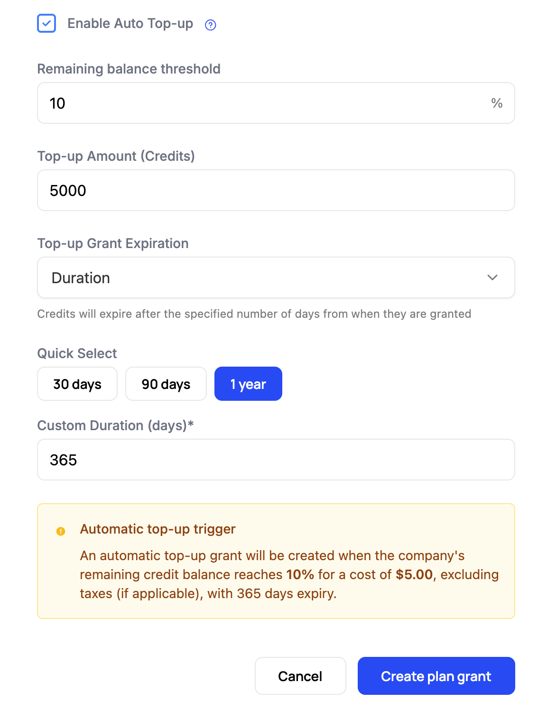

A plan grant refills a company's balance once per period. When a customer needs more before then, they buy it in one of two ways. A **credit bundle** is a one-time purchase the customer makes when they choose. **Auto top-up** buys credits on the customer's behalf whenever the balance drops below a threshold, so work never stops for a refill.

Both charge at the price you set and add a grant to the company's balance with its own expiry. Customers can buy bundles under any [empty-balance policy](/billing/empty-credit-balances), while auto top-up is one of those policies.

## Credit bundles

A credit bundle is a fixed number of credits at a fixed price, such as 10,000 credits for \$90. Customers buy bundles through checkout and the customer portal. Bundles are how a customer on Block usage or User-controlled top-ups gets unblocked without waiting for the next reset, and how you offer volume discounts on larger purchases.

### Create a bundle

Bundles belong to a credit type. Go to **Catalog** > **Credits**, open the credit type, and click **Create Bundle**.

1. Name the bundle, such as "Medium Bundle (10% off)".
2. Set the credit quantity.
3. Set a price. Pricing larger bundles at a lower rate per credit encourages customers to buy more at once.
4. Set the **Expiry Type**: a duration, the end of a billing period, or no expiry. These are the same options a one-time credit grant has. See [Grant expiration](/billing/credit-burndown#grant-expiration).

<Info>The price you set on a bundle is the basis for recognizing revenue from those credits. See [Revenue Recognition Data](/billing/revenue-recognition).</Info>

A bundle is not available to customers until it is live in your catalog. Go to **Catalog** > **Configuration**, click **+** in the **Credit Bundles** section, add the bundle, and click **Save Changes**. The [credit burndown walkthrough](/billing/credit-burndown#6-add-the-plan-and-bundles-to-the-catalog) shows each step.

### Choose which plans can buy it

On the **Live Credit Bundles** list in your catalog configuration, each bundle reads "Compatible with all plans" by default. Click it to open **Plan Compatibility Settings** and choose the plans under **Compatible Plans**. The change applies everywhere the bundle is live.

A company can buy any live bundle compatible with its plan, whatever top-up policy its credit grant uses. The customer portal shows a buy-more option on a credit balance when at least one live bundle for that credit is compatible with the company's plan.

### Where bundle credits go in the balance

Credits that expire sooner are spent first. A bundle with an expiry window is drawn before a plan grant that never expires, and a bundle with no expiry is drawn only once the shorter-dated grants are used up. See [Consumption order](/billing/credit-burndown#consumption-order).

## Auto top-up

Auto top-up buys credits automatically when a company's balance falls to a threshold, so a customer with a card on file is not cut off mid-workflow. You configure it on the plan's credit grant, in the same form as the reset and expiry settings.

<Note>
The credit type needs a cost basis before top-ups can be turned on. Without a per-unit price there is nothing to charge, so the top-up options are hidden and the form tells you the credit needs a per-unit price.
</Note>

1. Open the credit burndown plan you want to configure.
2. Click **Add credit grant**, or an existing grant.
3. Select the Credit Type and Credit Amount.
4. Choose **Automatic top-ups** or **User-controlled top-ups** for what happens when credits run out. See [Who controls auto top-up](#who-controls-auto-top-up).

5. Set the **Top-up Threshold**, the number of credits remaining that triggers a purchase. The balance it checks counts plan grants, purchased grants, and promotional grants.
6. Set the **Top-up Amount**, how many credits each top-up buys. The cost follows the credit type's cost basis and appears in the confirmation below.
7. Set the **Top-up Grant Expiration** for the purchased credits. Auto top-up grants offer Duration and No Expiry only. A one-year duration is a good default, long enough for customers to use the credits and short enough to keep revenue recognition simple.
8. Review the confirmation showing the final cost, threshold, and expiration, then click **Create plan grant**.

### Who controls auto top-up

| Mode | What happens |
| --- | --- |
| Automatic top-ups | Companies on this plan receive a top-up automatically when they reach the threshold. They cannot change or turn it off. |
| User-controlled top-ups | Companies turn auto top-up on themselves in checkout and the customer portal. Your threshold and amount become their starting defaults. |

Under User-controlled the Top-up Threshold and Top-up Amount fields are labeled "(default)", because the customer can change both. Which mode fits a plan is a policy decision, covered in [Choosing a policy](/billing/empty-credit-balances#choosing-a-policy).

### Per-company settings

Top-up settings live on the plan grant, so every company on that plan starts with the same threshold and amount. To give one company different values, set them on its grants through the [API](/api-reference/billing-credits/list-company-grants). The dashboard has no per-company top-up control.

Under User-controlled top-ups the customer changes their own threshold and amount, which covers many of the cases a per-company setting would.

### When a top-up fires

A top-up fires when a draw leaves the balance at or below the threshold. If several draws cross the threshold close together, only one top-up is purchased. If the purchase fails, Schematic retries on the next draw from the balance.

Three webhook events report each attempt: `auto.topup.success`, `auto.topup.hard.failure`, and `auto.topup.retry.exceeded`. A hard failure carries the Stripe error code when the failure originated there, so you can tell a declined card from a missing payment method. Subscribe to them under **Settings** > **Integrations** > **Webhooks**, and see [Entitlement & Credit Trigger Webhooks](/integrations/webhooks/entitlement-triggers#auto-topup-events) for the payloads.

A failed top-up means a customer is about to be cut off. Wire `auto.topup.hard.failure` to an internal alert and a customer-facing email before you turn auto top-up on.

## API fields

### Credit bundle

These live on `BillingCreditBundleResponseData`.

| App control | API field |
| --- | --- |
| Name of the credit bundle | `name` |
| Amount of credits | `quantity` |
| Credit bundle price | `price`, `currency_prices` |
| Expiry Type | `expiry_type`, `expiry_unit`, `expiry_unit_count` |
| Compatible Plans | `compatible_plan_ids`. An empty list makes the bundle available on every plan |

Update plan compatibility with [Update credit bundle details](/api-reference/billing-credits/update-credit-bundle-details).

### Auto top-up

Three fields on the [plan credit grant](/api-reference/billing-credits/create-billing-plan-credit-grant) configure top-ups: `auto_topup_availability`, `auto_topup_threshold_credits`, and `auto_topup_amount`. They are listed with the other empty-balance policy fields in [Handling Empty Credit Balances](/billing/empty-credit-balances#api-fields).

A grant bought by auto top-up carries `grant_reason` `billing_credit_auto_topup`, and a bundle purchase carries `purchased`. See [Grant sources](/billing/credit-burndown#grant-sources).

## Related

- [Credit Burndown Billing Model](/billing/credit-burndown) covers credit types, plan grants, and consumption order.
- [Handling Empty Credit Balances](/billing/empty-credit-balances) compares blocking, top-ups, and billing in arrears at zero.
- [Customer Portal](/components/customer-portal) shows the balance and the buy-more option to customers.
