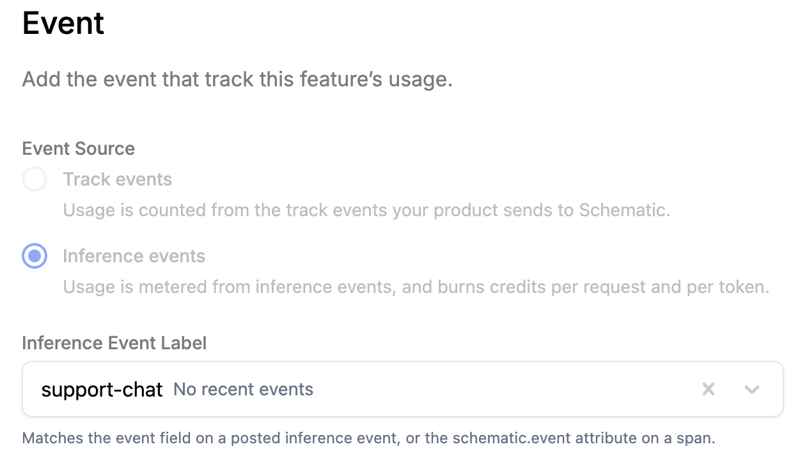
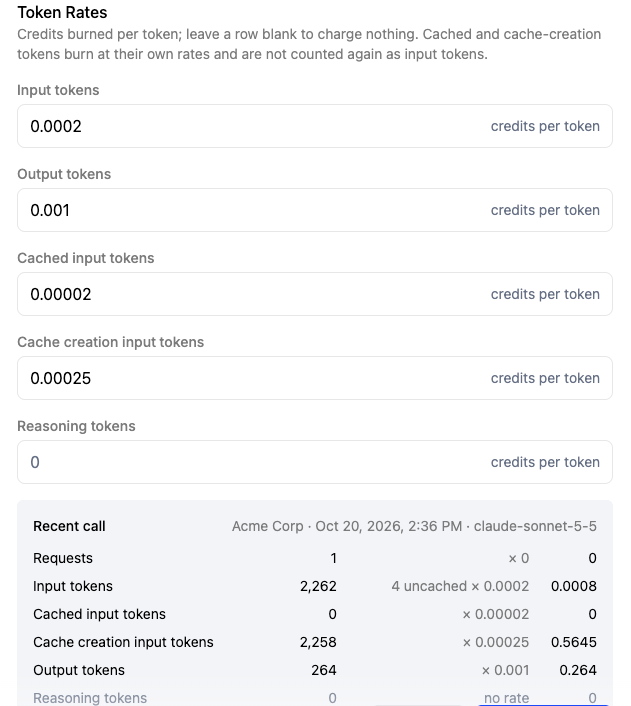
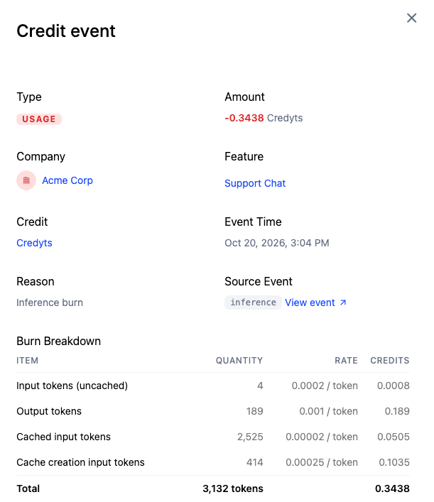

Every call your AI features make costs you by the token, and providers price input, output, cached input and cache writes differently. If you charge customers a flat rate per request, a long prompt and a one-line question cost them the same while costing you very different amounts.

With inference pricing, your app sends Schematic one inference event per model call, carrying the token counts the provider reported. Schematic burns credits from the company's balance at rates you set per request and per token type, and records every burn in the credit ledger with a line for each token type. Because you set the rates per plan, you can track your own costs closely and keep your margin when you switch models.

## How it works

1. Your app calls a model, then sends an inference event with the company, the model, and the token counts.
2. The event's name, in its `event` field, matches it to an **inference feature**: an event-based feature whose event source is inference events.
3. The company's plan gives that feature a credit burndown entitlement with a rate per request and a rate per token type.
4. Schematic multiplies each count by its rate, draws the total from the company's credit balance, and writes the draw to the credit ledger.

Inference features meter through credits. Each feature's entitlement is either credit burndown, which bills it, or unlimited, which grants access without billing it.

## Set up pricing in Schematic

This guide uses one AI feature, a support chat, priced in a credit type where one credit is worth one cent. If you have several AI features, repeat steps 2 and 3 for each. Giving each its own feature lets you set different rates when they run on different models.

### 1. Create a credit type

If you already sell credits, reuse that credit type. Otherwise create one as described in [Credit Burndown](/billing/credit-burndown), and give the plan a credit grant so companies on it start each period with a balance.

Choose a credit value that keeps token rates readable. At one cent per credit, a model that costs \$2 per million input tokens works out to 0.0002 credits per input token.

### 2. Create an inference feature

Create a feature with the type **Event-based**. In the **Event** section, set **Event Source** to **Inference events**. In the **Inference Event Label** field, type an event name such as `support-chat` and choose **Create event**, or pick an event name your app already sends. Your app sends this name in the `event` field of each inference event. An event without a matching name is still recorded, but it burns no credits.

The event source is fixed once the feature exists, so choose it when you create the feature.



### 3. Add the feature to a plan with token rates

Open the plan, add the feature, and set **Monetization Type** to **Credit burndown** against your credit type. Then fill in the rates.

| Field | What it prices | Example, one credit = 1¢ |
|---|---|---|
| Consumption rate | Each model call, whatever its size | 0 |
| Input tokens | Prompt tokens that were neither read from nor written to a cache | 0.0002 |
| Output tokens | Generated tokens, including any reasoning the provider counts in output | 0.001 |
| Cached input tokens | Prompt tokens read from the provider's prompt cache | 0.00002 |
| Cache creation input tokens | Prompt tokens written to the provider's prompt cache | 0.00025 |
| Reasoning tokens | Reasoning tokens, priced on top of output tokens | 0 |

The example rates follow a model that costs \$2 per million input tokens, \$10 per million output tokens, \$0.20 per million cache reads, and \$2.50 per million cache writes, so each call burns roughly what it costs. Multiply them to add your margin.

Leave the reasoning rate at 0 and count reasoning as output, as the provider samples below do. A consumption rate of 0 bills on tokens only, which works as long as at least one token rate is above 0. Leave a token rate blank to charge nothing for that token type.

Below the rates, the form shows what a recent call to the feature burns at the rates you entered, line by line, so you can check the numbers before you publish.



Publish the plan and put a company on it. A company burns credits only when its plan includes the feature and it has a credit balance.

## Send inference events

Send one inference event after each model call completes, with a **secret** API key. Publishable keys cannot send inference events.

```bash title="cURL"
curl -X POST https://api.schematichq.com/events \
  -H "X-Schematic-Api-Key: $SCHEMATIC_SECRET_KEY" \
  -H "Content-Type: application/json" \
  -d '{
    "event_type": "inference",
    "body": {
      "company": { "id": "acme" },
      "user": { "id": "user-42" },
      "event": "support-chat",
      "provider": "anthropic",
      "request_model": "claude-sonnet-5-5",
      "response_model": "claude-sonnet-5-5",
      "input_tokens": 2667,
      "cached_input_tokens": 2259,
      "cache_creation_input_tokens": 404,
      "output_tokens": 104
    }
  }'
```

Sending the event after the response reaches your user keeps Schematic off the request path. If your model call streams, send the event once the stream finishes, from the usage on the final response.

### Event fields

| Field | Required | Description |
|---|---|---|
| `company` | Yes | Keys that identify the company, the same keys you use in identify calls |
| `user` | No | Keys that identify the user who made the request |
| `event` | To burn credits | The event name of the feature to bill |
| `provider` | Yes | The model provider, for example `anthropic`, `openai` or `gcp.gemini` |
| `response_model` | Yes | The model that served the call, as the provider's response reports it |
| `request_model` | No | The model you asked for |
| `input_tokens` | Yes | Every prompt token, **including** cache reads and cache writes |
| `cached_input_tokens` | No | The part of `input_tokens` read from a prompt cache |
| `cache_creation_input_tokens` | No | The part of `input_tokens` written to a prompt cache |
| `output_tokens` | Yes | Generated tokens, including reasoning |
| `reasoning_tokens` | No | Reasoning tokens, priced at the reasoning rate on top of output |
| `requests` | No | How many calls this event covers. Defaults to 1 |
| `reservation_id` | No | Settles a credit reservation, see [Leases and reservations](/billing/credit-leases-and-reservations) |

### Count input tokens the way Schematic does

Schematic treats `input_tokens` as the whole prompt, and `cached_input_tokens` and `cache_creation_input_tokens` as parts of it. When it burns credits, it subtracts the two cache counts from `input_tokens` and prices the remainder at the input rate, so every prompt token is priced once, at the rate for how it was served.

OpenAI and Gemini report input the same way. Anthropic's Messages API reports `input_tokens` as only the uncached part of the prompt, so add the two cache counts to it before you send. If you send Anthropic's number as is, Schematic subtracts cache counts from a number that never contained them, and the uncached tokens go unbilled.

| Schematic field | Anthropic Messages API | OpenAI Responses API | OpenAI Chat Completions | Gemini API |
|---|---|---|---|---|
| `input_tokens` | `input_tokens` + `cache_read_input_tokens` + `cache_creation_input_tokens` | `input_tokens` | `prompt_tokens` | `promptTokenCount` |
| `cached_input_tokens` | `cache_read_input_tokens` | `input_tokens_details.cached_tokens` | `prompt_tokens_details.cached_tokens` | `cachedContentTokenCount` |
| `cache_creation_input_tokens` | `cache_creation_input_tokens` | omit | omit | omit |
| `output_tokens` | `output_tokens` | `output_tokens` | `completion_tokens` | `candidatesTokenCount` + `thoughtsTokenCount` |
| `response_model` | `model` | `model` | `model` | `modelVersion` |

Anthropic and OpenAI count reasoning inside output already. Gemini reports thinking separately in `thoughtsTokenCount` and bills it as output, so add it to `output_tokens`.

Send `response_model` from the response rather than the model you requested. They differ when a request uses a model alias or a fallback model serves it.

### Provider samples

Each sample makes one call, then sends the event with this helper:

```typescript title="sendInferenceEvent.ts"
export async function sendInferenceEvent(body: Record<string, unknown>) {
  await fetch("https://api.schematichq.com/events", {
    method: "POST",
    headers: {
      "Content-Type": "application/json",
      "X-Schematic-Api-Key": process.env.SCHEMATIC_SECRET_KEY!,
    },
    body: JSON.stringify({ event_type: "inference", body }),
  });
}
```

<CodeBlocks>
```typescript title="Anthropic"
const message = await anthropic.messages.create({ model, max_tokens: 1024, messages });

const usage = message.usage;
const cacheRead = usage.cache_read_input_tokens ?? 0;
const cacheWrite = usage.cache_creation_input_tokens ?? 0;

await sendInferenceEvent({
  company: { id: companyId },
  event: "support-chat",
  provider: "anthropic",
  request_model: model,
  response_model: message.model,
  input_tokens: usage.input_tokens + cacheRead + cacheWrite,
  cached_input_tokens: cacheRead,
  cache_creation_input_tokens: cacheWrite,
  output_tokens: usage.output_tokens,
});
```

```typescript title="OpenAI"
const response = await openai.responses.create({ model, input });

const usage = response.usage!;

await sendInferenceEvent({
  company: { id: companyId },
  event: "support-chat",
  provider: "openai",
  request_model: model,
  response_model: response.model,
  input_tokens: usage.input_tokens,
  cached_input_tokens: usage.input_tokens_details?.cached_tokens ?? 0,
  output_tokens: usage.output_tokens,
});
```

```typescript title="Gemini"
const response = await ai.models.generateContent({ model, contents });

const usage = response.usageMetadata!;

await sendInferenceEvent({
  company: { id: companyId },
  event: "support-chat",
  provider: "gcp.gemini",
  request_model: model,
  response_model: response.modelVersion ?? model,
  input_tokens: usage.promptTokenCount ?? 0,
  cached_input_tokens: usage.cachedContentTokenCount ?? 0,
  output_tokens: (usage.candidatesTokenCount ?? 0) + (usage.thoughtsTokenCount ?? 0),
});
```
</CodeBlocks>

## Chat and one-shot features

Chat and other multi-turn features resend the same system prompt and conversation on every turn. With prompt caching on, a provider charges a fraction of the input price to read that repeated prompt, and on Anthropic a premium to write it the first time. Most of a chat turn's prompt arrives as cached input or cache creation, so a chat feature needs rates for both, alongside input and output.

When a cache entry expires between turns, the next turn reads nothing from the cache. On Anthropic that turn writes the prompt to the cache again and reports it as cache creation, so it burns at the cache creation rate. OpenAI and Gemini report no cache creation tokens, so on those providers the same tokens arrive as ordinary input.

One-shot features such as classification, extraction or a single summary send a different, often short prompt each time. They rarely repeat a prompt long enough to cache, so their events carry input and output only, and those two rates cover them.

## Check that it works

Make a model call as a company on the plan, then:

1. Open **Events**. The inference event appears with the counts your app sent.
2. Open the company and click **View Ledger** under **Credit Balance**. Each call appears as an inference burn on your credit type.
3. Click a row to open the credit event. Its **Burn Breakdown** lists each quantity that burned credits, with its count, rate and credits, and **Source Event** links back to the inference event.



If the event arrives but nothing burns, check these in order:

- The `event` field matches the feature's event name exactly.
- The company's plan includes the feature as credit burndown, and the plan version is published.
- The company has a credit balance in that credit type.

## Related

- [Credit Burndown](/billing/credit-burndown) covers credit types, grants and bundles.
- [Leases and reservations](/billing/credit-leases-and-reservations) hold credits before a long or concurrent call runs, then settle the hold with the inference event.
- [Preflight checks](/feature-management/preflight-checks) check whether a company can afford a call before you make it.
