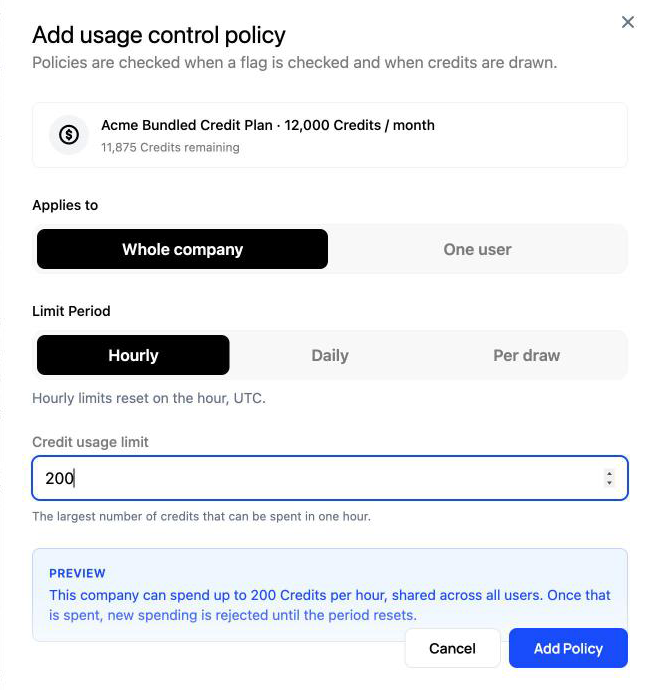
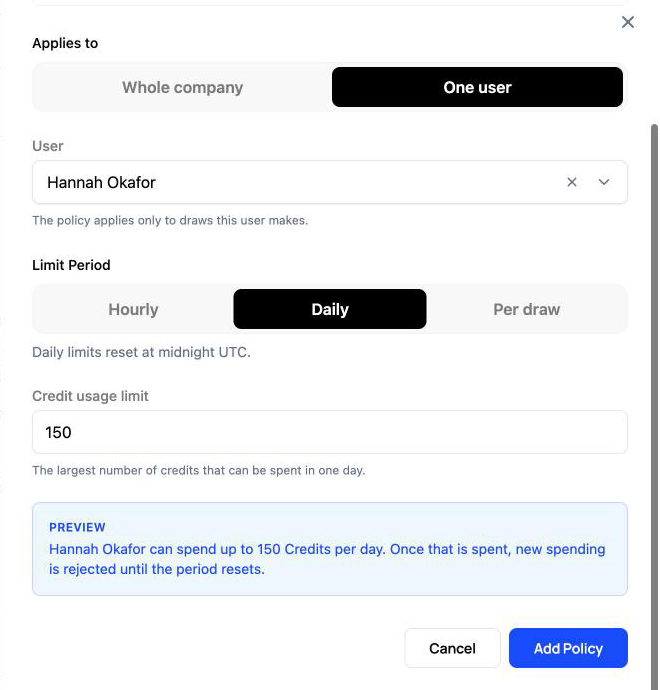
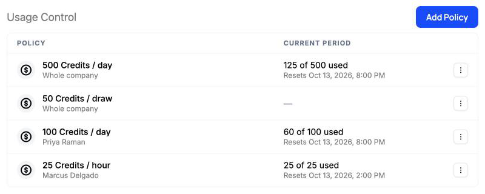

A credit balance sets how much a company can spend in total, but not how fast or by whom. One runaway agent or one heavy user can drain a month of credits in an afternoon, and the rest of the team logs in to an empty balance. Usage controls let you set a ceiling on the rate: a company, or a single user at that company, can spend up to a set number of credits per hour, per day, or per request, and Schematic refuses spending past that ceiling until the period resets.

Usage controls apply to [credit burndown](/billing/credit-burndown) features. They sit on top of the balance rather than replacing it, so a draw has to fit both the balance and every policy that applies to it.

## How a policy works

Each policy has three settings.

| Setting | Options |
| --- | --- |
| Applies to | **Whole company**, or **One user** at the company |
| Limit Period | **Hourly**, **Daily**, or **Per draw** |
| Credit usage limit | The number of credits allowed in the period, or in one draw |

When a company holds more than one credit type, you also pick the **Credit Type** the policy limits.

Hourly limits reset on the hour and daily limits reset at midnight, both on the UTC clock. A per-draw limit has no period. It caps how many credits a single request may spend, and is covered in [Per-draw limits](#per-draw-limits).

A whole-company policy counts every draw against the credit, shared across all of the company's users. A one-user policy counts only the draws attributed to that user, so it relies on your app sending `user` alongside `company` when it tracks usage and checks flags. See [Attributing draws to an actor](/billing/seat-and-agent-budgets#attributing-draws-to-an-actor).

Policies stack. A company can carry an hourly, a daily, and a per-draw policy at the same time, and each of its users can carry their own on top. A draw goes through only when every policy that applies allows it. Each company or user can have one per-draw policy and one policy per period for each credit type. Adding a second daily policy for the same user returns an error, so edit the existing one instead.

## Adding a policy

Open the company in Schematic and go to the **Entitlements** tab. The **Usage Control** section sits below **Credit Balance**. Click **Add Policy**.



Choose who the policy applies to, the period, and the limit. The **Preview** box spells out what the policy will do before you save it. For example, it reads "This company can spend up to 200 Credits per hour, shared across all users" for a whole-company hourly limit.

To limit one person or agent, choose **One user** and select them from the company's users.



Once saved, each policy appears in the Usage Control table. The **Current period** column shows how much of the limit has been spent so far and when it resets, in your local time. Per-draw policies have no period, so that column stays empty for them. Use the menu at the end of a row to edit or delete a policy.



## Where limits are enforced

Schematic applies policies wherever a draw is decided, which is during flag checks and when credits are held. Track events are recorded rather than decided, so they always go through.

| Where | What Schematic measures | Company policies | User policies |
| --- | --- | --- | --- |
| [Flag check](/feature-management/flags) | The usage the check describes, or one unit at the feature's consumption rate when the check describes none | Applied | Applied |
| [Check and reserve](/billing/credit-leases-and-reservations#checking-and-reserving-in-one-call) | The cost of the operation being reserved | Applied | Applied |
| [Reservation](/billing/credit-leases-and-reservations#reservations) | The reservation amount | Applied | Not applied, because a reservation names no user |
| [Lease](/billing/credit-leases-and-reservations#leases) acquire or extend | The amount requested | Applied | Applied when the request includes `user_id` |
| Track event | Never refused. The usage counts toward hourly and daily limits | Counted | Counts that user's share |

When a policy refuses a flag check, the flag returns false and the check's reason names the policy, such as `A draw of 2.5 credits exceeds the user limit of 25 credits per hour`. Your app handles that the same way it handles a company that has run out of credits.

When a policy refuses a reservation or a lease, the request fails with a `400`. For an hourly or daily limit, the message names how much remains and when the limit resets. For a per-draw limit, it names the limit the request went over:

```text
This request would spend 120 credits, but only 40 remain under the user limit of 100 credits per day until 2026-10-14T00:00:00Z. Request a smaller amount, wait for the limit to reset, or change the spend policy.

This request would spend 60 credits, above the company limit of 50 credits per request. Request a smaller amount, or change the spend policy.
```

Because track events are never refused, the last request in a period can carry the total past the limit. The overshoot is still billed against the balance, and the next check or hold in that period is refused.

## Per-draw limits

A per-draw limit stops any single request from spending more than a set number of credits, however much the company has left for the day. It is the policy to use when one oversized action is the risk, such as an agent run that can fan out into thousands of model calls, or a bulk export priced by row count.

A draw is one request for credits. Schematic can only refuse an oversized request if your app says how large the request is before it runs. A flag check with no usage attached is priced at a single unit at the feature's consumption rate, so a per-draw limit seldom refuses it. Pass the expected size with the check, and size it as an upper bound for the work.

With a backend SDK, pass `usage` to `check`. The check reserves that many units, and Schematic refuses it when the cost exceeds a per-draw limit:

```typescript
const result = await client.check(
  {
    company: { id: "northwind" },
    user: { user_id: "support-bot" },
  },
  "agent-runs",
  {
    usage: estimatedSteps, // upper bound for this run
    eventSubtype: "agent_steps",
  },
);

if (!result.allowed) {
  // result.reason names the policy that refused the run
  return showLimitMessage(result.reason);
}

const run = await runAgent(/* ... */);
await client.trackWithReservation(result.reservation, run.stepsUsed);
```

Calling the API directly, pass the expected cost in `preflight` on [Check flag](/api-reference/features/check-flag). `credit_cost` takes the cost in credits, keyed by credit type ID. Use `usage` or `event_usage` instead when you only know the quantity, and Schematic applies the consumption rate:

```bash
curl -X POST https://api.schematichq.com/flags/agent-runs/check \
  -H "X-Schematic-Api-Key: $SCHEMATIC_API_KEY" \
  -H "Content-Type: application/json" \
  -d '{
    "company": { "id": "northwind" },
    "user": { "user_id": "support-bot" },
    "preflight": {
      "credit_cost": { "bilcr_EXAMPLE0123456789": 2000 }
    }
  }'
```

Under a 500-credit per-draw limit, this check returns false with the reason `A draw of 2000 credits exceeds the company limit of 500 credits per request`. A run estimated at 300 credits passes, so many small runs go through while one oversized run is stopped before it starts.

Reservations and leases are measured by the amount they hold, so a per-draw limit also caps how large a single reservation or lease can be.

## Showing limits to your users

The React, Vue, and Angular SDKs expose the policies that apply to the current company and user. In React, `useSchematicCreditSpendPolicies` returns them along with what has been spent in the current period. The list updates over DataStream as usage comes in and whenever a policy is added, edited, or deleted, so the numbers stay current without polling.

```tsx
import { useSchematicCreditSpendPolicies } from "@schematichq/schematic-react";

function UsageLimits() {
  const { policies, isLoading } = useSchematicCreditSpendPolicies();
  if (isLoading) return null;

  return policies
    .filter((policy) => policy.kind === "window")
    .map((policy) => (
      <p key={policy.id}>
        {policy.consumed} of {policy.limit} credits used
        {policy.resetsAt && `, resets ${policy.resetsAt.toLocaleTimeString()}`}
      </p>
    ));
}
```

Company policies come first in the list. Each policy carries `kind` (`window` or `per_draw`), `scope` (`company` or `user`), `limit`, `consumed`, and, for windowed policies, `resetsAt` and `window`.

On the backend, [Check flags](/api-reference/features/check-flags) returns the same policies in `credit_spend_policies`, with `consumed` and `resets_at` for each windowed policy, so a server-rendered page can show the same numbers.

## Managing policies through the API

Policies can be created and managed with a secret API key, which lets you set limits from your own admin tools or apply them as part of provisioning a customer.

| Method | Path | Purpose |
| --- | --- | --- |
| `GET` | `/billing/credits/spend-policies` | List policies, filtered by `billing_credit_id`, `company_id`, `user_id`, `user_ids`, or `scope_type` |
| `POST` | `/billing/credits/spend-policies` | Create a policy |
| `GET` | `/billing/credits/spend-policies/{spend_policy_id}` | Get one policy |
| `PUT` | `/billing/credits/spend-policies/{spend_policy_id}` | Change a policy's limit, period, or label |
| `DELETE` | `/billing/credits/spend-policies/{spend_policy_id}` | Delete a policy |
| `GET` | `/billing/credits/spend-policies/usage` | List policies with their spend in the current period |
| `GET` | `/billing/credits/spend-policies/count` | Count policies |

A policy names its credit type and exactly one of `company_id` or `user_id`. Set `window_amount` and `window_unit` for an hourly or daily limit, or `max_per_draw` for a per-draw limit. A policy holds one or the other, so a company that needs both gets two policies.

```bash
curl -X POST https://api.schematichq.com/billing/credits/spend-policies \
  -H "X-Schematic-Api-Key: $SCHEMATIC_API_KEY" \
  -H "Content-Type: application/json" \
  -d '{
    "billing_credit_id": "bilcr_EXAMPLE0123456789",
    "user_id": "user_EXAMPLE0123456789",
    "window_amount": 100,
    "window_unit": "day",
    "label": "Support agent daily cap"
  }'
```

| Field | Values |
| --- | --- |
| `billing_credit_id` | The credit type the policy limits. Required |
| `company_id` | The company the policy applies to. Set this or `user_id` |
| `user_id` | The user the policy applies to. Set this or `company_id` |
| `window_amount` | Credits allowed per period. Requires `window_unit` |
| `window_unit` | `hour` or `day` |
| `max_per_draw` | Credits allowed in a single draw. Set this or `window_amount` |
| `label` | Optional, up to 255 characters |

The usage route returns each windowed policy with `consumed`, `headroom`, and `resets_at` for the current period, which is what an admin view needs to draw a meter without a second call.

## Related

- [Credit Leases and Reservations](/billing/credit-leases-and-reservations) — how holds work, and how to take one for a single operation
- [Seat and Agent Budgets](/billing/seat-and-agent-budgets) — attributing draws to users and agents, and reporting on them
- [Spend & Usage Controls](/billing/spend-controls) — every limit, threshold, and top-up setting in one place
- [Handling Empty Credit Balances](/billing/empty-credit-balances) — what happens when the balance itself runs out
