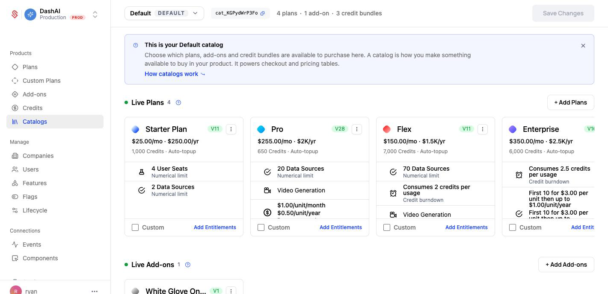
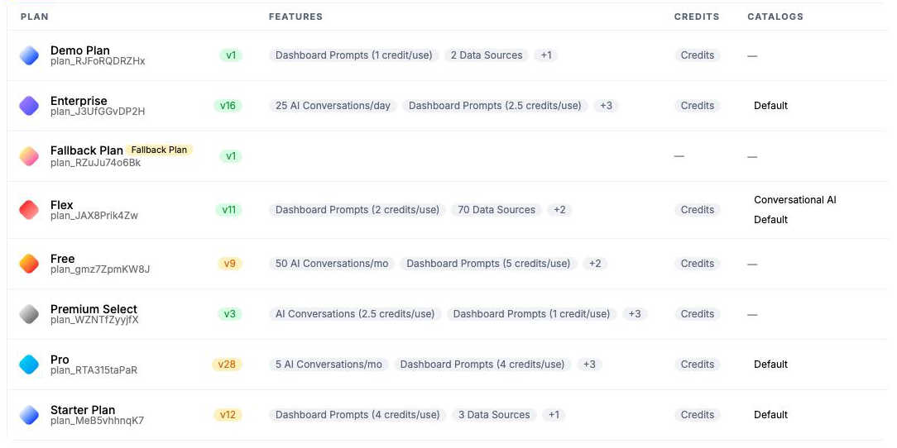
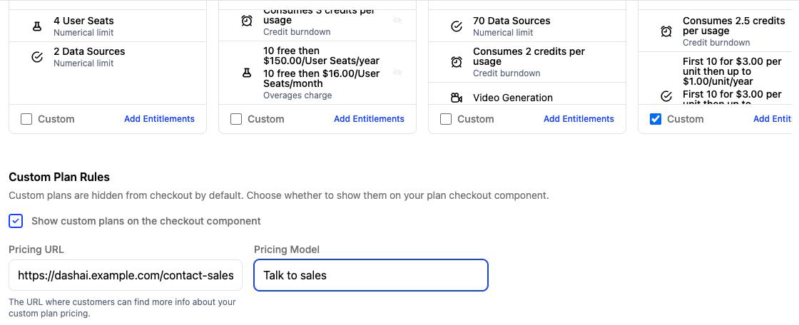
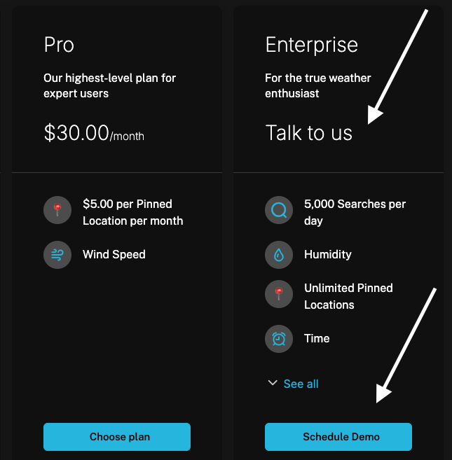
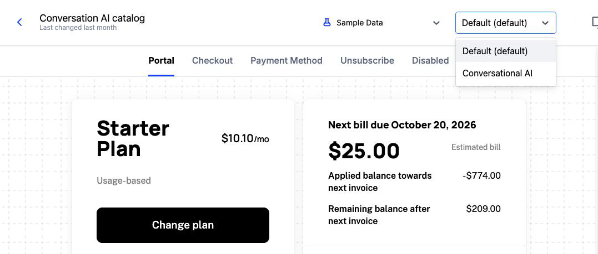
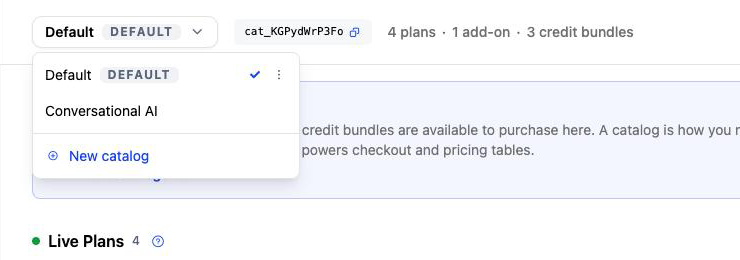

A catalog is the set of plans, add-ons, and credit bundles a customer can buy. Checkout and the pricing table resolve against a catalog, so what you put in one is exactly what that customer sees and can purchase.

Every account starts with one catalog, and most only ever need it. You build a second catalog when you need to sell a different lineup to different people out of the same account, without duplicating plans or branching your application code.

<Info>
Catalogs control self-serve purchasing through Schematic Components, which requires Stripe. If you use Schematic without Stripe, your components are read only and you can skip this page. See [Stripe](/integrations/stripe) for connecting your billing products.
</Info>

## Use cases

### Selling more than one product

Once you sell two products, a single list of purchasable plans forces a compromise. Your AI plans and your analytics plans land in the same checkout, and you either show every customer everything or write conditional logic in your app to hide the half that does not apply.

Give each product its own catalog and the choice goes away. Analytics customers open a portal backed by the analytics catalog and see analytics tiers. AI customers see AI tiers. A plan the two products share, such as a common enterprise tier, sits in both catalogs and still counts as one plan with one version history.

### Selling to different buyers

A two-sided marketplace charges its supply side and its demand side for different things, at different prices, often on different terms. Restaurants pay a commission on orders; diners pay for a membership. One pricing table cannot serve both.

Build a catalog per side. Each side's portal points at its own catalog, and each buyer sees only the plans written for them. The settings that should not differ by side, such as your trial rules and plan change rules, stay shared across both catalogs, so the two sides behave consistently even though they buy different things.

## What a catalog holds

Each catalog has three sections. Companies can still be assigned a plan or add-on that is not in any catalog, through the Schematic app or the API, but they cannot buy it on their own through a component.

### Live Plans

Live Plans are the plans your end users can subscribe to, upgrade to, or downgrade from. Each plan in the list appears as an option in checkout and on the pricing table, in the order you set here.

A Live Plan always surfaces its **latest** published version. Companies already on a prior version stay there until you [migrate them](/catalog/plans#plan-version-migrations).

A plan can belong to more than one catalog. The **Plans** list has a Catalogs column showing every catalog each plan appears in, so you can see at a glance which of your products sells a given plan.

### Showing a plan without a price

An enterprise tier often has negotiated pricing that you do not publish, but you still want it on the pricing table so buyers know it exists. Tick **Custom** on the plan's card in Live Plans, and a **Custom Plan Rules** panel opens below the list:

- **Show custom plans on the checkout component** puts these plans in checkout. They are hidden from checkout until you turn it on.
- **Pricing Model** is the text a customer sees in place of a price, such as "Talk to sales" or "Volume-based pricing".
- **Pricing URL** is where a customer goes to learn more, such as your contact-sales page.

This is different from a [custom plan](/catalog/custom-plans), which is a plan scoped to a single company and never offered in checkout.

<Info>
Custom plans are typically billed by having Stripe send the customer an invoice to pay. If those invoice emails aren't arriving, see [My customer didn't receive an invoice email](/integrations/stripe-troubleshooting#my-customer-didnt-receive-an-invoice-email). The most common cause is testing in a Stripe sandbox, which doesn't send customer emails by default.
</Info>

### Live Add-ons

Live Add-ons are the add-ons a customer can attach to a subscription in checkout. Like Live Plans, each one surfaces its latest published version.

### Live Credit Bundles

Live Credit Bundles are the credit packs a customer can buy, each with its own price, credit amount, expiration, and plan compatibility. See [Credit Burndown](/billing/credit-burndown) for how purchased credits are spent.

## Connecting a catalog to a component

Every component sells from exactly one catalog. Open a component in the Component Builder (**Components > Classic Builder**) and choose its catalog from the dropdown in the top toolbar, beside the preview data selector. Checkout, the pricing table, and the plan picker inside that component then draw only on the plans in the catalog you chose. Click **Save** to apply the change.

This is where a second catalog earns its keep. You embed one portal in your dashboard product and another in your AI product, point each at its own catalog, and each set of customers sees only the plans that apply to them.

## Your default catalog

Schematic creates a catalog named **Default** for you and moves your existing Live Plans, Live Add-ons, and Live Credit Bundles into it. Every component in your account points at that catalog. Your customers see the same plans at the same prices as before, and you add a second catalog only when you have a reason to.

The default catalog is marked with a `DEFAULT` badge and cannot be deleted. You can rename or delete any catalog you create alongside it.

## Catalogs and lifecycle settings

Live Plans and Live Add-ons used to sit on the Catalog's Configuration tab, next to the initial plan, the fallback plan, and the trial rules. Those settings now live on their own page:

| Where it lives | What it controls |
| --- | --- |
| **Products > Catalogs** | Which plans, add-ons, and credit bundles are purchasable, and in what order they appear |
| **Manage > Lifecycle** | Initial plan, fallback plan, trial rules and trial expiry, plan change rules, checkout settings, and component display settings |

[Lifecycle settings](/catalog/lifecycle) apply across every catalog, so a trial rule or a plan change rule you set once governs all of them. Catalog membership is the part you vary.

## Catalogs are account-wide

Like plans and features, catalogs are [account scoped rather than environment scoped](/developer_resources/environments#account-scoped-resources). A catalog you create carries the same name and the same ID in development, staging, and production, so you model a new product once and promote it without rebuilding it in each environment.

## Editing a catalog

1. Navigate to **Products > Catalogs**
2. To build a new catalog, open the catalog dropdown at the top left, choose **New catalog**, give it a name and an optional description, and click **Create Catalog**. To change an existing one, select it from the same dropdown.
3. Add plans, add-ons, and credit bundles using **+ Add Plans**, **+ Add Add-ons**, and **+ Add Credit Bundles**
4. Click **Save Changes**
5. If you created a new catalog, open the component that should sell this lineup and point it at the new catalog

<Info>
Plans and add-ons must be associated with Stripe products to be added to a catalog.
</Info>

## Common pricing table patterns

A useful pattern is to lay out your pricing table where each plan includes the features of the previous plan plus some additional features. This is common in 3-tier ("Good, Better, Best") pricing tables often used by SaaS companies. It usually looks like this:

| Good       | Better                       | Best                          |
|------------|------------------------------|-------------------------------|
|            | Everything in Good, plus:    | Everything in Better, plus:   |
| Feature A  | Feature D                    | Feature F                     |
| Feature B  | Feature E                    | Feature G                     |
| Feature C  | Feature F                    | Feature H                     |

Order the plans this way in Live Plans, then enable the `plans.showInclusionText` option on the pricing table component. For more details, see the [Pricing Table documentation](/components/pricing-table#styling-options-for-the-pricing-table).
