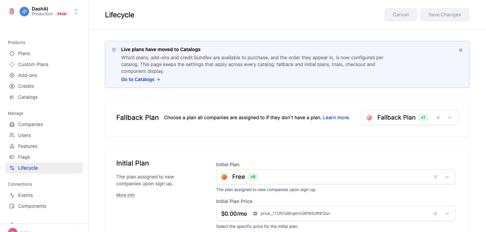
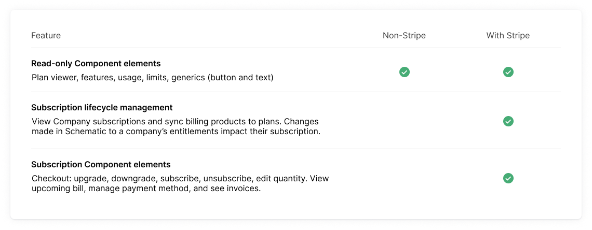
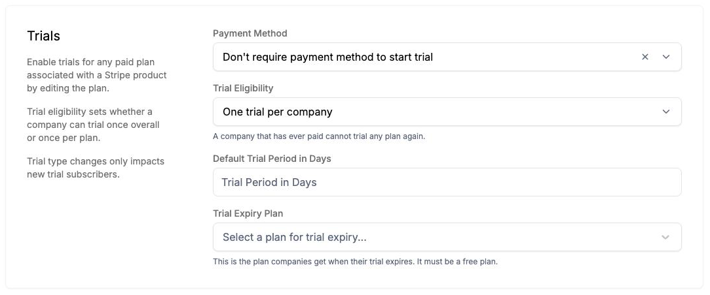
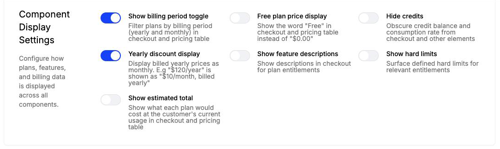
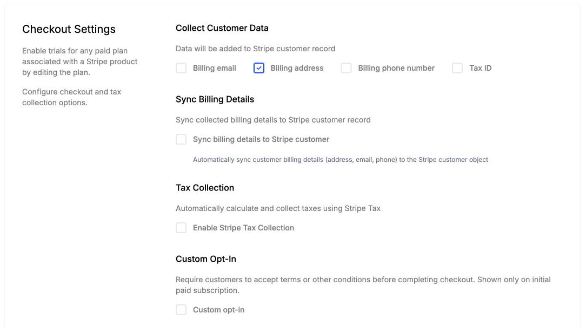
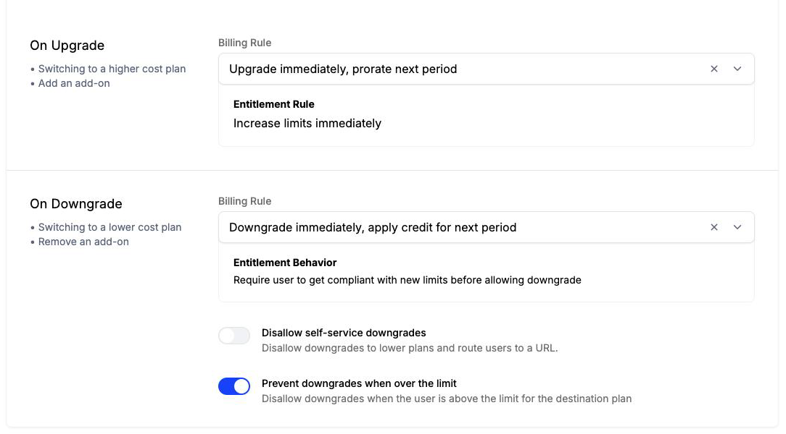

Lifecycle settings, under **Manage > Lifecycle**, govern a subscription from the moment a company is created until it changes plans or lapses. They apply across every [catalog](/catalog/catalogs), so a company follows the same trial and plan change rules whichever product it buys. You choose which plans are for sale on the Catalogs page.

The initial and fallback plans work whether or not you bill through Stripe. Trials, checkout settings, and plan change rules govern self-serve subscriptions, so they take effect only when your plans are connected to Stripe. Without Stripe, your components are read only.

To change any of these settings, open **Manage > Lifecycle**, make your changes, and click **Save Changes**.

## Fallback Plan

The plan assigned to any company that does not have another base plan. This replaces the deprecated Default Plan functionality, and allows you to specify a default set of entitlements.

These plans cannot be linked to a billing product (even a free plan).

**When Applied:**
Companies are automatically moved to this plan when their subscription becomes inactive (unpaid, cancelled).

## Initial Plan

The plan assigned to new companies when they are created. This plan determines how new customers begin their journey with your service.

You can select a price for this initial plan, in which case a Stripe subscription will be provisioned for this customer.

Your initial plan selections must _not_ require the customer to have a payment method on file, meaning any of the following are valid:
* Selecting a plan that is not associated with billing
* Selecting a plan and price that is free, with no monetized entitlements (e.g. pay-as-you-go, tiered pricing, or pay-in-advance)
* Selecting a plan with a trialable paid plan, as long as the trial will expire at the end of the trial term

<Info>
If you want every new company to have a corresponding Stripe customer record from the start, configure the Initial Plan to use a plan with a **$0 price**. This causes Schematic to provision a Stripe customer and a $0 subscription for each new company automatically. Without this, Stripe customers are only created when a company subscribes to a Stripe-enabled plan. Companies on free plans with no Stripe price will not appear in Stripe.
</Info>

The Initial, Fallback, and Trial Expiry plans each resolve to the plan's latest published version. Companies already on a prior version stay there until you [migrate them](/catalog/plans#plan-version-migrations).

## Trials

You turn on a trial for an individual plan when you [edit the plan](/catalog/trials). The settings here decide how every trial behaves. Changes apply to new trials only, so companies already in a trial keep the terms they started with.

**Payment Method** sets whether a company needs a payment method on file to start a trial. If it does, the company converts into the paid plan automatically when the trial ends. If it does not, the company moves to the Trial Expiry Plan.

**Trial Eligibility** sets who Schematic offers a trial to: one trial per company, which is the default, or one trial per plan. See [Trial eligibility](/catalog/trials#trial-eligibility) for what each rule counts and how to choose between them.

### Trial Expiry Plan

The plan companies are moved to when their trial period expires.

**Requirements:**
- Must not require a payment method
- Must be either:
  - A non-billing-linked plan, OR
  - A plan with a free price
- Cannot be a trialable plan (companies can't go onto a second trial)

## Component Display Settings

These settings control how plans, features, and billing data render in every component in your account.

| Setting | What it does |
| --- | --- |
| **Show billing period toggle** | Lets customers filter plans by monthly or yearly billing in checkout and the pricing table |
| **Free plan price display** | Shows the word "Free" instead of "$0.00" in checkout and the pricing table |
| **Hide credits** | Hides the credit balance and consumption rate from checkout and other elements |
| **Yearly discount display** | Shows yearly prices as a monthly amount, so "$120/year" reads as "$10/month, billed yearly" |
| **Show feature descriptions** | Shows each entitlement's description in checkout |
| **Show hard limits** | Shows the hard limit on entitlements that define one |
| **Show estimated total** | Shows what each plan would cost at the customer's current usage in checkout and the pricing table |

## Checkout Settings

These settings decide what Schematic collects from a customer during checkout and what it passes to Stripe.

| Setting | What it does |
| --- | --- |
| **Collect Customer Data** | Asks for billing email, billing address, billing phone number, or tax ID, and adds what the customer enters to their Stripe customer record |
| **Sync Billing Details** | Keeps the address, email, and phone on the Stripe customer object in step with what the customer enters |
| **Tax Collection** | Calculates and collects tax through [Stripe Tax](/integrations/stripe-advanced-use-cases#stripe-tax) |
| **Custom Opt-In** | Requires the customer to accept your terms or other conditions before completing their first paid subscription |
| **Custom Checkout Fields** | Collects extra fields from every customer and passes each one to Stripe as customer metadata under the key you configure |

## Plan Change Rules

Schematic validates every self-serve plan change against these rules. Switching to a higher-cost plan or adding an add-on counts as an upgrade. Switching to a lower-cost plan or removing an add-on counts as a downgrade.

**On Upgrade**, the billing rule upgrades the company immediately and prorates the next period, and the company's limits increase right away.

**On Downgrade**, the billing rule either applies the downgrade immediately with a prorated credit, which is the default, or [schedules it for the end of the billing period](/catalog/managing-company-plans#scheduled-downgrades). Two more settings control whether a customer can downgrade at all:

- **Disallow self-service downgrades** blocks downgrades in components and sends the customer to a URL you choose, such as your support or sales page. It is off by default.
- **Prevent downgrades when over the limit** blocks a downgrade while the company's usage is above the destination plan's limits. It is on by default.

See [Preventing Downgrades](/catalog/managing-company-plans#preventing-downgrades) for how these play out for a company.
