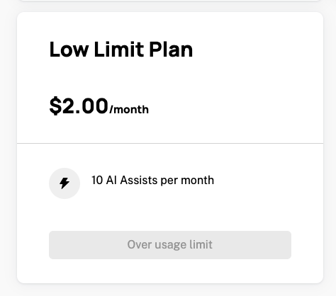
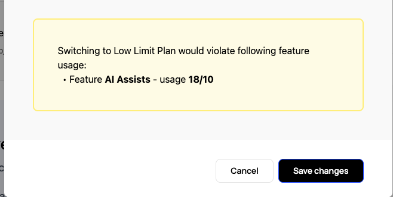
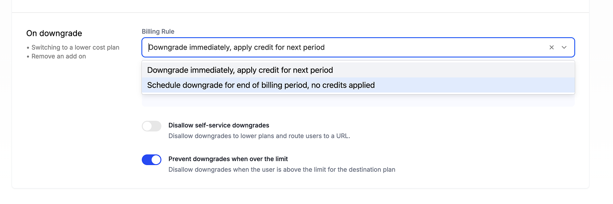
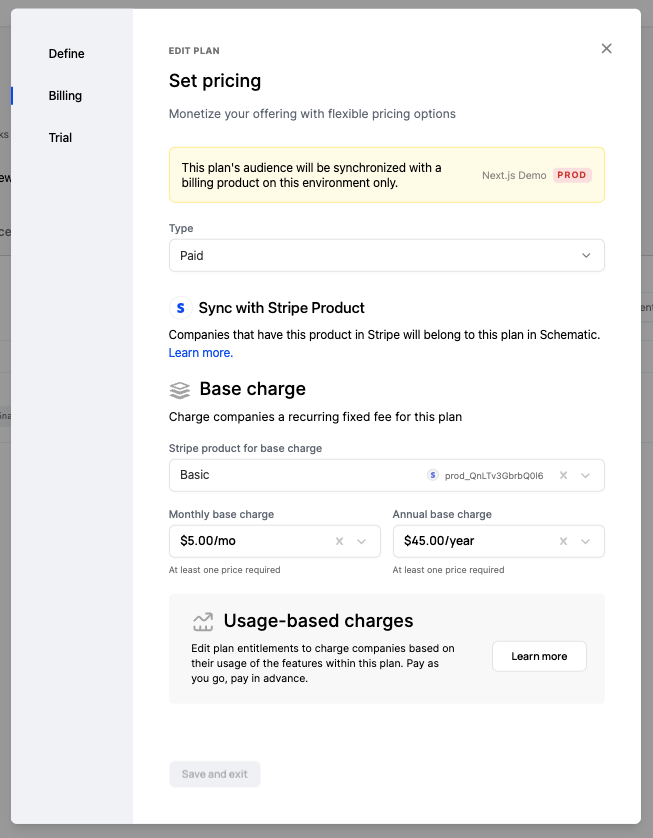
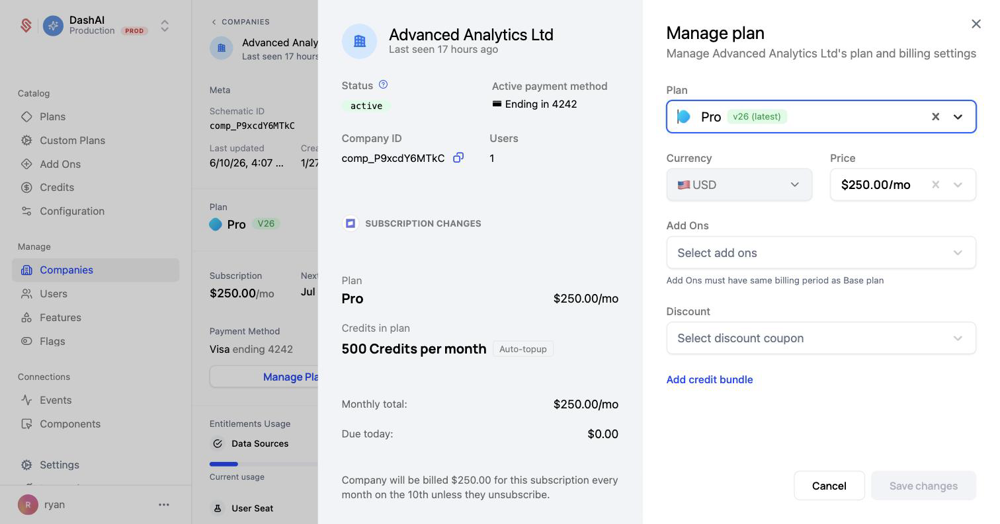
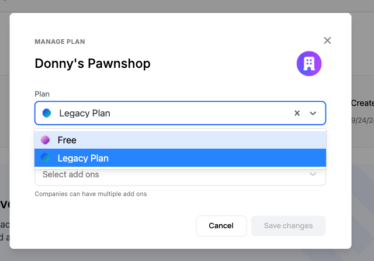

Assigning company plans in Schematic allows you to define the features, limits, and pricing available to each of your customers. 

This doc covers
- [Company initiated plan changes](#company-initiated-plan-changes)
- [Automatically assigning plans to companies](#ways-to-assign-plans-to-companies)
- [Manually changing a company's plan](#changing-plans)
- [Invoicing a new subscription](#invoicing-a-new-subscription)

## Company initiated plan changes

When a company changes plans, whether an upgrade or a downgrade, Schematic automatically updates the company's entitlements, usage limits, and billing status in Stripe (if applicable). Downgrades can be applied immediately or [scheduled for the end of the billing period](#scheduled-downgrades). Plan changes can occur from a few different sources -- in all cases, the steps Schematic takes are the same. The possible reasons for a plan change are:

- The customer goes through a checkout flow via the Schematic Customer Portal Component
- You update a company's plan via the Schematic App using the "Manage Plan" button
- You migrate the company to a new plan version (see [Plan Versions](/catalog/plans#plan-versions))
- A customer's trial period ends, and they are converted to the default plan
- A customer fails to pay their bill, their subscription is marked `unpaid` in Stripe, and they are downgraded to the default plan

### Plan Change Basics

Whenever a plan changes, Schematic will automatically update the company's entitlements and usage limits. Accrued usage is fully preserved. All company overrides are preserved and re-applied. If a company override is less generous than the current plan entitlement, the more generous amount will be applied. 

This applies to [plan version migrations](/catalog/plans#plan-version-migrations) as well: when a company is migrated to a new version of its plan, its entitlement limits and price are updated to the new version (with prorations for price changes), while accrued usage and overrides are preserved. Companies that are not migrated stay on their current version and keep their existing entitlements and price until you migrate them later.

Schematic prevents companies from downgrading to a plan if they will be over the usage limits of the new plan. 

Using the "Manage Plan" button in the Schematic App, you are able to downgrade a company to a plan even if they are over the usage limits of the new plan. This will display a warning:

### Stripe-Linked Plans

Stripe-linked plans have additional considerations concerning how usage based charges are synced to Stripe. 

### Upgrade vs. Downgrades

For Stripe-linked plans, Schematic handles upgrades and downgrades differently. A plan change is considered an upgrade if the new plan has a higher base price (or the same base price) as the current plan. A downgrade is considered a plan change to a plan with a lower base price.

### Upgrade/Downgrade logic

When determining if a plan change is an upgrade or downgrade, the following logic is used. Below are the steps for determining if a change is an upgrade, whereas the inverse is considered a downgrade.

1. Both plans need to be paid (otherwise it's a subscribe/unsubscribe)
2. If the new plan has a longer billing period (e.g. monthly -> yearly), it's an upgrade.
3. If the new plan has a higher base price, it's an upgrade.
4. If the new plan includes a new add-on, it's an upgrade.
5. If the new plan includes more Pay-in-advance usage (typically representing user seats), it's an upgrade.
6. If the new plan includes the purchase of a credit bundle, it's an upgrade.

### Period Changes 

When a company upgrades to a new plan, Schematic will maintain the current billing period (e.g. if you are 15 days into your billing period, you will remain on day 15 after the upgrade). 

However, if the plan change is a downgrade, Schematic will reset the billing period (e.g. the new plan will start on day 1 of the new billing period). If [scheduled downgrades](#scheduled-downgrades) are enabled, the downgrade is deferred to the end of the current billing period and the customer retains access to their current plan until then.

### Proration

Additionally, when changing plans, Schematic will use Stripe's proration logic to refund the remaining **base** cost of the current plan and the **base** cost of the new plan. These costs are presented to the user during the checkout flow or to you while using the "Manage Plan" button in the Schematic App.

For usage-based features, Schematic will carry over usage from the current plan to the new plan.

### Preventing Downgrades

Schematic allows you to prevent customers from downgrading to a plan if they are over the usage limits of the new plan. This is the **Prevent downgrades when over the limit** setting under [Plan Change Rules](/catalog/lifecycle#plan-change-rules), and it is turned on by default.

Additionally, you can require customers reach out to you before they can downgrade to a plan (preventing self-service downgrades). This is the **Disallow self-service downgrades** setting in the same section, and it is turned off by default.

### Scheduled Downgrades

If this setting is selected, when a customer downgrades their plan, the downgrade is scheduled for the end of the current billing period rather than applied immediately. The customer retains full access to their current plan until the billing period ends, and no proration or credits are applied.

This behavior is controlled by the **Billing Rule** under **On Downgrade** in [Plan Change Rules](/catalog/lifecycle#plan-change-rules). The available options are:

- **Schedule downgrade for end of billing period, no credits applied** takes effect at the end of the current billing period. The customer keeps their current entitlements until then.
- **Downgrade immediately, apply credit for next period** (default) applies the downgrade right away and gives the customer a prorated credit for the remainder of their billing period.

In Stripe, a scheduled downgrade appears as a [subscription schedule](https://docs.stripe.com/billing/subscriptions/subscription-schedules) on the company's subscription, which changes the plan at the billing period boundary.

#### Behavior while a downgrade is scheduled

While a downgrade is scheduled, the customer continues to use their current plan with full access to all entitlements. However, certain actions are blocked until the downgrade takes effect or is canceled:

- **Add-on purchases** are blocked
- **Pay-in-advance purchases** (e.g. seats) are blocked
- **Credit purchases** are blocked

These restrictions ensure the customer's subscription remains in a consistent state leading into the scheduled plan change. However, the customer can always cancel the downgrade at any time via the component and then do any action.

#### Canceling a scheduled downgrade

A scheduled downgrade can be canceled if the customer resubscribes to a paid plan or upgrades before the billing period ends. When this happens, the scheduled downgrade is removed and the customer's subscription continues as normal.

This guide walks you through the ways to assign plans to companies, manage plan changes, and ensure your customers have the right access at the right time.

## Ways to assign plans to companies

Additionally, you can control which plan a company is on directly.

### Stripe integration (recommended)

When integrated with Stripe, Schematic automatically syncs products and subscriptions for each of your customers (read more [here](/integrations/stripe)). This allows you to:
- Link Stripe subscriptions directly to Schematic plans.
- Automatically update company access based on subscription changes in Stripe.
- Use Stripe's billing capabilities while leveraging Schematic for subscription and feature management.

Simply mapping a Stripe product to a Schematic plan will ensure that those that have a subscription with the mapped product will be assigned the corresponding plan in Schematic.

## Changing Plans

How plans are managed in Schematic depends on whether you've integrated Stripe or not.

### Using Stripe

If you've integrated Stripe, Schematic offers several ways to handle plan changes:

**On the company profile page in Schematic**

You can manage a company's plan directly on the company profile page in Schematic using the **Manage Plan** button. These changes automatically sync with Stripe to update a company's subscription. The company's current plan version is shown both on the profile (e.g. a "v3" badge) and in the Manage Plan panel; assigning a plan here uses its latest published version. 

<Info>If you're having trouble, see the [Stripe FAQ](/integrations/stripe-troubleshooting) for more information.</Info>

When you start a new subscription here, you can bill it by invoice instead of charging a card. See [Invoicing a new subscription](#invoicing-a-new-subscription). When a sales-led deal needs its own pricing or entitlements, create a [custom plan](/catalog/custom-plans) for the company from the 3-dot menu on its profile instead, giving that one company negotiated terms without affecting your standard plans.

**Self-service components**

By embedding Schematic components in your application, you can allow your users to manage plans and add-ons independently. Read more about components [here](/components/overview). Any changes made via a component will automatically sync with Stripe.

Components allow users to:
- Upgrade or downgrade plans
- Add or remove add-ons
- Manage quantity for usage-based features

**Within Stripe**

If you prefer to make changes directly in Stripe, Schematic will automatically sync those updates and update plans, add-ons, and entitlements.

### Not using Stripe

If you're not using Stripe, manage a company's plan directly on the company profile page in Schematic.

<Info>You currently are not able to move a company from a plan that is not associated with a Stripe product to a Stripe-associated plan.</Info>

## Invoicing a new subscription

Sales-led customers usually pay by invoice on net terms, and asking them for a card they never intend to use stalls the deal. When you start a subscription from the **Manage Plan** panel, you can bill it by invoice and keep the company on a plan from your catalog. When the deal needs its own pricing or entitlements, use a [custom plan](/catalog/custom-plans) instead.

The payment fields appear when the company has no active subscription and you pick a plan that is linked to a Stripe product. How a subscription is paid is set when it starts, so to move a company that already has a subscription onto invoicing, cancel that subscription and start a new one.

### Choosing how the subscription is paid

**Payment method** offers three options:

| Option | What happens |
|--------|--------------|
| **Charge payment method** | Stripe charges the card or other payment method on file. |
| **Send an invoice** | Stripe emails an invoice to the **Billing email** with the **Payment terms** you pick, from Net 7 to Net 60. Leave **Payment terms** empty for Net 30. |
| **Paid outside of Stripe** | Use this when the customer has already paid, for example by bank transfer against a quote. Schematic records the first invoice in Stripe as paid without emailing it, and the company gets the plan straight away. |

If the company has a billing profile, the panel starts on the profile's payment method and says so under the field. **Paid outside of Stripe** only asks for a billing email when the company's Stripe customer has none, because Stripe needs one to issue the invoice even though nobody receives it.

### Deciding when the company gets the plan

With **Send an invoice**, **Plan activation** decides when the company gets the plan and its add-ons:

- **Activate immediately** gives the company the plan when the subscription starts. The invoice stays open until it is paid, and an overdue invoice follows your Stripe settings for late payments.
- **Activate when the invoice is paid** keeps the company on its current plan and add-ons until the invoice is paid.

<Warning>
If an invoice under **Activate when the invoice is paid** goes past due, Schematic cancels the subscription and voids the invoice, and the company never receives the plan. Choose **Activate immediately** for customers who need a grace period after the due date.
</Warning>

The panel locks **Plan activation** to **Activate immediately** when you add a credit bundle, because the credits are granted right away, and when the first period is free, because no invoice is raised until the renewal date.

### Setting the renewal date

Order forms often name a renewal date, such as the first of the year, that falls on a different day from the one the subscription starts. **Billing period renewal date** sets the day the subscription renews on, and it renews on that day every period after. This field is available for any new paid subscription, invoiced or not.

The time between today and the renewal date becomes a shortened first period, and **Bill the First Period** decides whether the customer pays for it:

- **On** (the default) raises a prorated invoice now, covering today up to the renewal date.
- **Off** makes that period free, and no invoice is raised until the renewal date. Turn it off when the customer has already paid for the time until renewal.

**Paid outside of Stripe** disappears from **Payment method** while the first period is free, because there is no invoice to record as paid. Once a subscription exists, the panel shows its renewal date read-only, and changing it means cancelling and restarting the subscription.

To set up the same terms from code, see [Invoicing a subscription](/developer_resources/manage-plan-api#invoicing-a-subscription) in the Manage Plan API.
