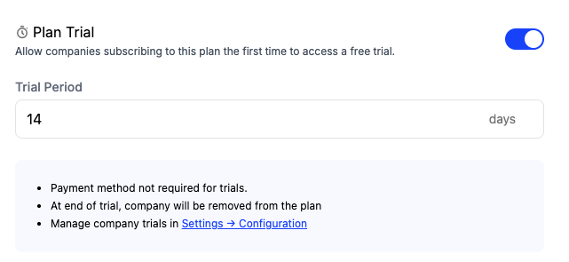

You can enable whether a plan has a trial or not when creating or editing a plan. Because editing a plan [creates a new plan version](/catalog/plans#plan-versions), trials configurations can be adjusted whenever a new plan version is published. When a trial period is defined for a plan, Schematic will ensure that the company receives the corresponding entitlements for that period the first time they are assigned that plan. 

You choose whether payment is required up front under [Trials in Lifecycle settings](/catalog/lifecycle#trials). If it is required, the company converts into the corresponding paid plan automatically when the trial ends. If not, the company moves to your [Trial Expiry Plan](/catalog/lifecycle#trial-expiry-plan).

<Info>If you change trial configuration (e.g. whether a trial is a part of a plan, credit card requirement), any companies currently in a trial will be unaffected, and the new setting will apply going forward.</Info>

## What a plan with a trial can include

A company on a trial may have no payment method on file, so Schematic only lets a plan carry a trial when nothing on it charges for usage during the trial window. It applies the same rule when you save the plan, when you add an entitlement or credit grant to a plan with a trial, and when you start a trial for a company from Manage Plan, and it refuses the change if anything on the plan would bill during the trial.

| On the plan | Allowed with a trial | Why |
| --- | --- | --- |
| Entitlement with no price | Yes | Nothing is billed for it. |
| [Pay in advance](/billing/usage-based-billing#pay-in-advance) entitlement | Yes | The purchased quantity is a licensed price, like the plan price, and bills \$0 during the trial. |
| [Credit burndown](/billing/credit-burndown) entitlement | Yes | Usage draws on granted credits. |
| [Pay as you go](/billing/usage-based-billing#pay-as-you-go) entitlement | No | Usage bills during the trial. |
| [Fixed fee with overage](/billing/usage-based-billing#fixed-fee-with-overage) entitlement | No | Usage past the included amount bills during the trial. |
| Tiered entitlement, [volume](/billing/usage-based-billing#volume-pricing) or [graduated](/billing/usage-based-billing#graduated-pricing) | No | Usage bills during the trial. |
| Credit grant set to [Block usage](/billing/empty-credit-balances#block-usage) | Yes | Credit-metered features stop at zero and nothing is charged. |
| Credit grant with [Automatic top-ups](/billing/empty-credit-balances#automatic-top-ups) or [User-controlled top-ups](/billing/empty-credit-balances#user-controlled-top-ups) | No | A top-up charges the company during the trial. User-controlled top-ups count because they run until the company turns them off. |
| Credit grant set to [Bill in arrears](/billing/empty-credit-balances#bill-in-arrears) | No | Usage past zero is invoiced. |
| [Billed credit grant](/billing/credit-burndown#billed-credit-grants) on a custom plan | No trial from Manage Plan | The grant's credits are issued as soon as the plan is assigned, so a \$0 trial would hand them over unpaid. |

A pay-in-advance entitlement, such as a seat count, bills nothing until the trial ends. At the end of the trial it follows the same **Payment Method** rule in [Lifecycle settings](/catalog/lifecycle#trials) as the plan price: a company that converts is billed for its quantity along with the plan, and a company that moves to the Trial Expiry Plan is not billed for it.

### Where the rule is checked

| Where | What Schematic does |
| --- | --- |
| **Plan Trial** step of the plan editor | Shows "Plans with **usage-based entitlements** (pay as you go, overages, tiered) cannot be trial enabled because they bill on usage during the trial." when the plan has one, and "A plan with a trial can't have **credit grants that bill in arrears or top up automatically**, because they bill on usage during the trial." when a grant tops up or bills in arrears. Saving the trial returns "A plan with a trial can't have pay-as-you-go, overage, or tiered entitlements." or "A plan with a trial can't have credit grants that bill in arrears or top up automatically." |
| Entitlement form on a plan with a trial | Refuses pay as you go, overage, and tiered with "Usage-based entitlements (pay as you go, overages, tiered) cannot be added to trial plans." Pay in advance can be added. |
| Credit grant form on a plan with a trial | **When credits run out** offers only Block usage, with the note "A plan with a trial can only block usage at zero, since top-ups and billing in arrears would charge during the trial." |
| Manage Plan, with **Enable Trial** turned on for a company | Shows "Cannot use trial with pay-as-you-go entitlements" or "Cannot use trial with billed credit grants". A plan with a top-up or arrears grant is refused on submit with "A trial can't be combined with credit grants that bill in arrears or top up automatically." Pay-in-advance quantities, such as seats, can be set on a trial. |

The plan editor applies grant changes before it checks the trial, so you can change the last top-up or arrears grant to Block usage and turn on the trial in the same save.

A credit grant that already tops up or bills in arrears on a plan with a trial keeps its policy in the credit grant form and stays editable. Schematic only refuses a change that moves a grant from Block usage to a top-up or arrears policy while the plan has a trial.

## Trial eligibility

Trial eligibility decides whether Schematic offers a company a trial at all, and you choose the rule under **Trial Eligibility** in [Lifecycle settings](/catalog/lifecycle#trials).

**One trial per company** is the default. Once a company holds a subscription that charges money, Schematic stops offering it a trial on any plan from then on. A $0 subscription, such as a free plan assigned at signup, does not spend that eligibility, and neither does an abandoned checkout.

**One trial per plan** lets a company trial each plan once. A company already paying for Starter can start a trial on Pro, and a company that has trialed Pro cannot trial Pro a second time. Extending, cancelling, or deleting a trial does not make a company eligible again for a plan it already trialed.

Choose one trial per plan when customers evaluate your plans separately, such as a core plan they buy now and a higher tier they grow into a year later. Keep the default when the trial is how a customer starts with you and each company should get exactly one.

Your pricing table and checkout read the same eligibility answer, so a trial the pricing table advertises is a trial checkout will start.

<Info>If your companies were running trials before September 2026, talk to us before you switch to one trial per plan. Some of those earlier trials may not count toward the rule, which would let a company trial a plan it already trialed, and we can fix that before you switch.</Info>

### Granting a trial from the dashboard

When you change a company's plan from the dashboard, Schematic tells you whether that company has already trialed the plan you selected, or is not eligible for a trial on it, before you turn the trial on.

## Rendering trial state in your app

Once trials are configured, you can surface trial state directly in your UI. Schematic's React and Vue SDKs expose the current company's plan name, trial status, and trial end date, so you can build things like plan badges, trial countdown banners, and post-trial conversion flows without any additional API calls.

For example, you can show a "Trial" chip with a countdown, prompt expired trial users to upgrade, or render a different experience for companies that converted from a trial versus those that never trialed at all.

See the [React SDK docs](/developer_resources/sdks/react#company-plan-information) or [Vue SDK docs](/developer_resources/sdks/vue#company-plan-information) for usage details.
