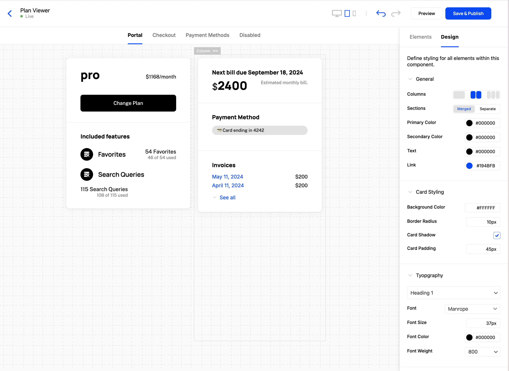
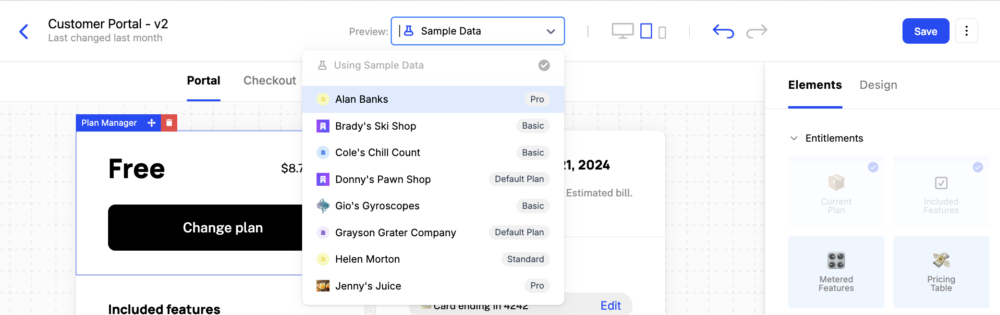

Before embedding a component in your application, you'll create and configure it in Schematic. This covers both setting up your catalog (so the component has the right plans and pricing to display) and building the component itself.

## Configuring the Catalog

1. Navigate to **Products > Catalogs**, which opens your Default catalog
2. Click **+ Add Plans** and choose the plans your end users can upgrade to or downgrade from. These are your Live Plans.
3. Click **Save Changes**
4. Optionally, open **Manage > Lifecycle** and choose a [fallback plan](/catalog/lifecycle#fallback-plan) that companies are assigned when they have no subscription

<Info>Plans must be associated with Stripe Products to be added to a catalog. If you don't use Stripe, skip this section.</Info>

If you sell more than one product, you can build a catalog for each and point each component at its own. See [Catalogs](/catalog/catalogs).

## Creating a New UI Component

Once you've configured your Catalog, Components will be populated with your data rather than sample data (if you skip to this section, you can simply use the sample data).

1. Navigate to **Components** in the navigation bar
2. Click **New Component** and choose "Customer Portal" as an example
3. Click into the new Component you created and you should see a rendered Customer Portal in the Schematic Component Builder
4. Press **Save & Publish** and follow the [steps to drop into your application](/components/set-up)

Components are fully customizable both in the elements they are made up of (e.g. Current Plan, Included Features, Invoices, etc.) and in how they look and feel (so it appears native to your product).

Additionally, you may preview as any company in your account using the dropdown at the top of the builder.

