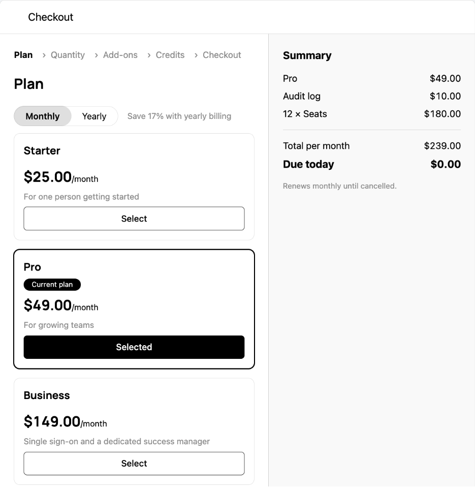

A purchase in a dialog: the plan and its billing period and currency, automatic top-ups, pay-in-advance quantities, add-ons and their quantities, credit bundles, then payment. The customer chooses, the server prices every change and says what is wrong with the cart, and the dialog decides only the order the choices are asked in. It reads the catalog and the company through the session on the provider, as described in the [Drop-in components overview](/components/drop-in/overview#the-session).



## Usage

```tsx
import { Checkout, SchematicStyles } from "@schematichq/schematic-components/elements";
import { useState } from "react";

export function Upgrade() {
  const [open, setOpen] = useState(false);
  return (
    <>
      <SchematicStyles />
      <button onClick={() => setOpen(true)}>Upgrade</button>
      <Checkout
        open={open}
        onOpenChange={setOpen}
        selection={{ planId: "plan_pro", period: "year" }}
        steps={{ skip: ["plan"] }}
        onComplete={(result) => console.log("subscribed", result.status)}
      />
    </>
  );
}
```

Nothing loads while the dialog is closed, and every opening starts a new cart from `selection` and what the company has now, so an inline `selection` object is fine. The dialog calls `onOpenChange(false)` when the customer closes it and when the purchase completes.

## Opening it from anywhere

A page usually opens the checkout from more than one place: a plan card, an over-limit prompt, a "buy more" link. `CheckoutLauncherProvider` renders one `<Checkout />` for the page, and `useCheckoutLauncher()` below it opens that dialog without holding its state:

```tsx
import {
  CheckoutLauncherProvider,
  CreditUsage,
  PlanManager,
  useCheckoutLauncher,
} from "@schematichq/schematic-components/elements";

export function Billing() {
  return (
    <CheckoutLauncherProvider defaults={{ steps: { hideSkipped: true } }}>
      <Cards />
    </CheckoutLauncherProvider>
  );
}

function Cards() {
  const { open } = useCheckoutLauncher();
  return (
    <>
      <PlanManager onChangePlan={() => open()} />
      <CreditUsage onBuyMore={() => open({ steps: { initial: "credits" } })} />
    </>
  );
}
```

`open(config)` lays each section of `config` (`selection`, `steps`, `display`, `catalogId`) over the same section of `defaults`. The launcher also exposes `close()` and `isOpen`. Outside a provider, `open` does nothing and says so on the console in development. The provider takes every `<Checkout />` prop except `open`, `onOpenChange` and the config sections, so `onComplete` and `formatProblem` sit on it once.

Each drop-in opens the checkout through a handler you pass. [Plan Manager](/components/drop-in/plan-manager), [Metered Features](/components/drop-in/metered-features), [Credit Usage](/components/drop-in/credit-usage) and the [Unsubscribe Button](/components/drop-in/unsubscribe-button) show their purchase action only when you pass one, and the [Pricing Table](/components/drop-in/pricing-table) calls `onSelectPlan` with a selection whose `checkout` field is ready to pass: `open({ selection: selection.checkout })`.

## Props

| Prop | Effect |
| --- | --- |
| `open`, `onOpenChange(open)` | Whether the dialog shows. `onOpenChange` is called with `false` when the customer closes the dialog or the purchase completes. |
| `selection` | What the cart starts with. See [What the cart starts with](#what-the-cart-starts-with). |
| `steps` | `skip`, `hideSkipped` and `initial`. See [The steps](#the-steps). |
| `display` | `showPeriodToggle`, `showCurrencySelector`, `showBillingDisclaimer`, `currencies`, `layout`, `summary` and `container`. See [Layout](#layout). |
| `catalogId` | Read `GET /catalogs/{catalog_id}/view` rather than the environment's catalog. |
| `onComplete(result)` | Called after the charge, and after the customer confirmed it where the payment needed that. The billing data the purchase changed is already reloading. |
| `onProblems(problems)` | Called each time the server's list of what is wrong with the cart changes. An empty list arrives before the first price. |
| `onStepChange(step)` | Called with each step shown: `plan`, `autoTopup`, `usage`, `addOns`, `addOnUsage`, `credits` or `payment`. |
| `formatProblem(problem)` | Your words for a problem, chosen by `problem.code`; return `undefined` to show the server's message. See [Problems](#problems). |
| `checkoutPrefill` | Values the card form starts with, as [Payment Methods](/components/drop-in/payment-methods) takes them. |
| `className`, `locale`, `strings` | A class on the root, a BCP 47 tag for number, currency and date formatting, and copy overrides by key. |

## What the cart starts with

`selection` names the cart's starting point; the customer edits from there.

| Field | Effect |
| --- | --- |
| `planId` | The plan to start on. Left out, the company's current plan, unless the company could still start a trial on that plan, in which case the customer chooses. `null` is no plan: a purchase of credit bundles alone. |
| `period` | `"month"`, `"quarter"` or `"year"`. Left out, the subscription's period, else monthly. |
| `currency` | An ISO 4217 code in either case. A subscription fixes the currency, so a change keeps it whatever `currency` says; a company without one gets the choice. |
| `addOnIds` | The add-ons to start with. Left out, the ones the company holds. |
| `quantities` | Pay-in-advance quantities by feature id, for the plan and its add-ons alike. Left out, what the company has now. |
| `creditBundles` | Bundles by bundle id with a count; a bundle sold one at a time takes any count above zero as one. |
| `autoTopup` | Automatic top-ups the company chooses, by plan credit grant id: `enabled`, `thresholdCredits` and `amount`. |
| `promoCode` | A promotion code applied before the first price. |
| `trial` | Start a trial when the plan offers one and the company can take it. Default `true`. |
| `customFields` | Custom checkout field values by field id; they win over the company's saved ones. |

The catalog's checkout settings in the dashboard decide what the checkout collects beside the card, such as a tax ID, custom fields, an address, email or phone, and whether bundles are bought one at a time.

## The steps

The dialog derives its steps from the catalog and the cart, in this order, each only when there is something to choose in it:

1. **Plan**, whenever the catalog sells plans, with the period toggle, a note on what a longer period saves, and the currency choice. A plan the company may not move to says why: the features it is over the limit for, or a downgrade rule, with a link to ask when the catalog names one. A catalog with a custom plan ends the cards with it and a link to ask in place of a price.
2. **Auto top-up**, when the plan has included credits whose top-up the company may set itself.
3. **Quantity**, when the plan has pay-in-advance entitlements.
4. **Add-ons**, when some add-on can be sold with the plan and no trial is starting.
5. **Add-on quantity**, when a chosen add-on has pay-in-advance entitlements.
6. **Credits**, when some bundle is sold with the plan in the cart's currency.
7. **Checkout**, always: the payment method, promo code, tax ID, custom fields and the agreement.

A trial that needs no card goes from the plan (and its top-ups) to the checkout step. With no plan and some bundles, the purchase is credits alone, and the plan step still shows, unselected, for the customer to pass.

`steps.skip` passes over the steps it names, except a plan step with no plan to fall back on and any step a blocking problem points at: a refused finalize takes the customer to the first step that can fix it. Skipped steps stay in the step list, where choosing one returns to it, unless `steps.hideSkipped`. `steps.initial` opens on a later step; a step the checkout does not have falls back to the first.

```tsx
import { Checkout } from "@schematichq/schematic-components/elements";
import { useState } from "react";

export function Seats() {
  const [open, setOpen] = useState(false);
  return (
    <>
      <button onClick={() => setOpen(true)}>Add seats</button>
      <Checkout
        open={open}
        onOpenChange={setOpen}
        selection={{ planId: "plan_pro", quantities: { feat_seats: 5 } }}
        steps={{ skip: ["plan"], initial: "usage", hideSkipped: true }}
      />
    </>
  );
}
```

## Layout

From 768px up, the steps take the left and the summary the right, each scrolling on its own; below that the summary sits under the steps and the action keeps to the bottom of the screen. Three `display` props change that:

| `display` | Effect |
| --- | --- |
| `layout: "stacked"` | The summary stays under the steps at every width and the whole dialog scrolls. The root carries `schematic-checkout--stacked`. |
| `summary: "payment"` | The summary shows on the payment step alone; the steps before it carry their Next action in `.schematic-checkout__nav`, and the layout carries `data-summary="payment"`. |
| `container: "inline"` | The checkout renders in the page where you put it, as a `section` with no backdrop and no close control, as tall as its content. The root carries `schematic-checkout--inline`, and `open` still says whether it renders at all. This is the shape for a checkout page of its own. |

`display.currencies` lists the currencies to offer, in order, with the first as the default, and `display.showCurrencySelector`, `showPeriodToggle` and `showBillingDisclaimer` hide the controls their names say. Everything else is CSS: the class names below are API, and a stylesheet rendered after `<SchematicStyles />` wins at equal specificity.

## Problems

Everything the server finds wrong with the cart arrives as a problem with a `code`, whether it is `blocking`, a `message` safe to show, and the ids of what it is about. The dialog shows each problem on the step that can fix it and disables Pay while a blocking one stands; the customer fixes the cart, not the rule. `formatProblem` substitutes your own words by code, and `onProblems` reports each new list:

```tsx
import { Checkout, type CheckoutProblem } from "@schematichq/schematic-components/elements";
import { useState } from "react";

export function Upgrade() {
  const [open, setOpen] = useState(false);
  const words = (problem: CheckoutProblem) =>
    problem.code === "payment_method_required" ? "Add a card first." : undefined;
  return (
    <Checkout
      open={open}
      onOpenChange={setOpen}
      formatProblem={words}
      onProblems={(problems) => console.log(problems.map((p) => p.code))}
    />
  );
}
```

The codes are the `CheckoutProblemCode` values the [Components API](/api-reference/components) reference lists on the checkout responses, such as `payment_method_required`, `selection_invalid` for a promotion code the server rejects, `usage_over_limit`, `downgrade_not_permitted` and `checkout_superseded`.

## Payment

The checkout pays with the company's default method on file, and lists any other method on file under it with a Use action. A new card goes through Stripe's Payment Element on a setup intent, so the checkout step needs `@stripe/stripe-js` and `@stripe/react-stripe-js`, the same peers as [Payment Methods](/components/drop-in/payment-methods); they load only when the form opens. A card saved there pays for this checkout and joins the company's methods on file as the default.

When the charge needs the customer, as with 3-D Secure, the finalize answers with a client secret and the dialog confirms the payment with Stripe before `onComplete`. A confirmation the customer fails or abandons leaves the checkout completed on the server. The action then reads Confirm payment and retries the confirmation alone, naming the card again because Stripe takes it off a failed intent, and `onComplete` fires once it goes through.

The tax ID saves on its own, when the field is left and again before a finalize, rather than on the cart. The agreement's text, when the catalog asks for one, may carry Markdown links, which render as links that open in a new tab; new copy clears the box, because accepting one wording is not accepting another.

## Before it can load

`GET /catalog/view` is gated on the `multi-product-catalog` flag and the `/company` reads on `company-context-api`, both per account. Without the first, the dialog says checkout is not available; without the second it still sells, without the currency lock and the company's current quantities. A catalog whose `capabilities.checkout` is false, because there is no Stripe integration, more than one subscription, or one managed elsewhere, shows the same notice. Ask Schematic to enable either flag for the account.

## Theming

The dialog reads the same `--schematic-*` tokens as every other element, and `--schematic-backdrop` colors the scrim behind it. [Styling and theming](/components/drop-in/styling) has the token list.

The root is `schematic-dialog schematic-checkout`, or a `section.schematic-checkout.schematic-checkout--inline` under `display.container: "inline"`. `.schematic-checkout__layout` carries `data-step` with the step on screen. Step links carry `aria-current="step"`, `data-state` (`done`, `current`, `upcoming`) and `data-skipped`; plan and add-on cards `data-selected` and `data-valid`; problems `data-code`.

| Class | Where |
| --- | --- |
| `schematic-checkout__frame` | The status frame inside the dialog body; `data-state` is `pending`, `error` or `ready`. |
| `schematic-checkout__unavailable` | The notice shown when the catalog cannot be bought from. |
| `schematic-checkout__layout` | The steps and the summary; one column, two from 768px up. |
| `schematic-checkout__main` | The left column: stepper, heading, the step on screen, its problems and navigation. |
| `schematic-checkout__stepper`, `__step`, `__step-link` | The step list, one `li` per visible step, the link within it. |
| `schematic-checkout__heading` | The step's title. |
| `schematic-checkout__section`, `__section-title` | A group within a step, with `data-step`. |
| `schematic-checkout__controls` | The period toggle and currency choice above the plan cards, or the currency choice alone on the first step shown when the plan step is skipped. |
| `schematic-checkout__cards`, `__card`, `__card-name`, `__card-price`, `__card-period` | Plan and add-on cards. |
| `schematic-checkout__card-description`, `__card-badges`, `__card--custom`, `__card-link` | A card's description and badges, the catalog's custom plan, and the link to ask under a blocked downgrade. |
| `schematic-checkout__rows`, `__row`, `__row-name`, `__row-detail`, `__row-amount` | Quantity, bundle and auto top-up rows. |
| `schematic-checkout__input`, `__input--quantity` | Text and number inputs. |
| `schematic-checkout__field`, `__field-label`, `__field-helper`, `__inline` | A labelled control, its helper, and a row of them. |
| `schematic-checkout__check`, `__opt-in-text`, `__opt-in-link` | The agreement checkbox, its text, and the links its Markdown carries. |
| `schematic-checkout__problems` | The problems on a step, each a `schematic-notice` with `data-code`. |
| `schematic-checkout__nav` | Back, and Next while the summary is held. |
| `schematic-checkout__summary`, `__summary-title` | The right column, an `aside` with `aria-busy` while pricing. |
| `schematic-checkout__action` | Next, or Pay now and its error, under the summary; sticky to the bottom of what scrolls when stacked. |
| `schematic-checkout__lines`, `__line`, `__line-amount`, `__lines--one-time`, `__line--one-time`, `__lines-caption` | What the cart holds, one line each, with the lines charged once grouped under a caption. |
| `schematic-checkout__totals`, `__total`, `__total--due`, `__total-amount`, `__total--proration`, `__proration-toggle`, `__proration`, `__proration-line` | Proration with its Show details toggle, discount, tax, the period's total, the credit applied and the amount due now. |
| `schematic-checkout__disclaimer` | The renewal, trial-end, scheduled-change, next-invoice proration and remaining-credit lines under the totals. |
| `schematic-checkout__methods`, `__use-method` | The other methods on file and each row's Use action; the card on file and the form carry the `schematic-payment-methods__*` classes. |

## Localizing it

The dialog's copy lives under `checkout*` keys: `checkoutTitle`, the step names `checkoutStepPlan`, `checkoutStepAutoTopup`, `checkoutStepUsage`, `checkoutStepAddOns`, `checkoutStepAddOnUsage`, `checkoutStepCredits` and `checkoutStepPayment`, the actions `checkoutNext`, `checkoutPay`, `checkoutConfirm` and `checkoutConfirmPayment`, and the `checkoutPromo*`, `checkoutTaxId*`, `checkoutProration*`, `checkoutDisclaimer*` and `checkoutTrial*` groups. `locale` formats every amount and date, so `locale="de-DE"` renders `1.852,53 $` and a German date, and `strings` renames one key:

```tsx
import { Checkout } from "@schematichq/schematic-components/elements";
import { useState } from "react";

export function Kasse() {
  const [open, setOpen] = useState(false);
  return (
    <Checkout
      open={open}
      onOpenChange={setOpen}
      locale="de-DE"
      strings={{ checkoutTitle: "Kasse", checkoutStepPayment: "Bezahlen" }}
    />
  );
}
```

`translate` on the provider routes every key through your i18n instead. See [Localization](/components/drop-in/localization).

## Build it yourself

The dialog is built on [`useCatalog`](/components/build-your-own/hooks#usecatalog), [`useCompany`](/components/build-your-own/hooks#usecompany), [`useCheckout`](/components/build-your-own/hooks#usecheckout) and [`useTaxIds`](/components/build-your-own/hooks#usetaxids), with `deriveCheckout` turning the catalog, cart and checkout into what it shows. [Checkout API](/components/build-your-own/checkout-api) describes the persisted checkout underneath, and [Checkout with Stripe Elements](/components/build-your-own/checkout-with-stripe-elements) builds the payment step by hand on the same routes.
