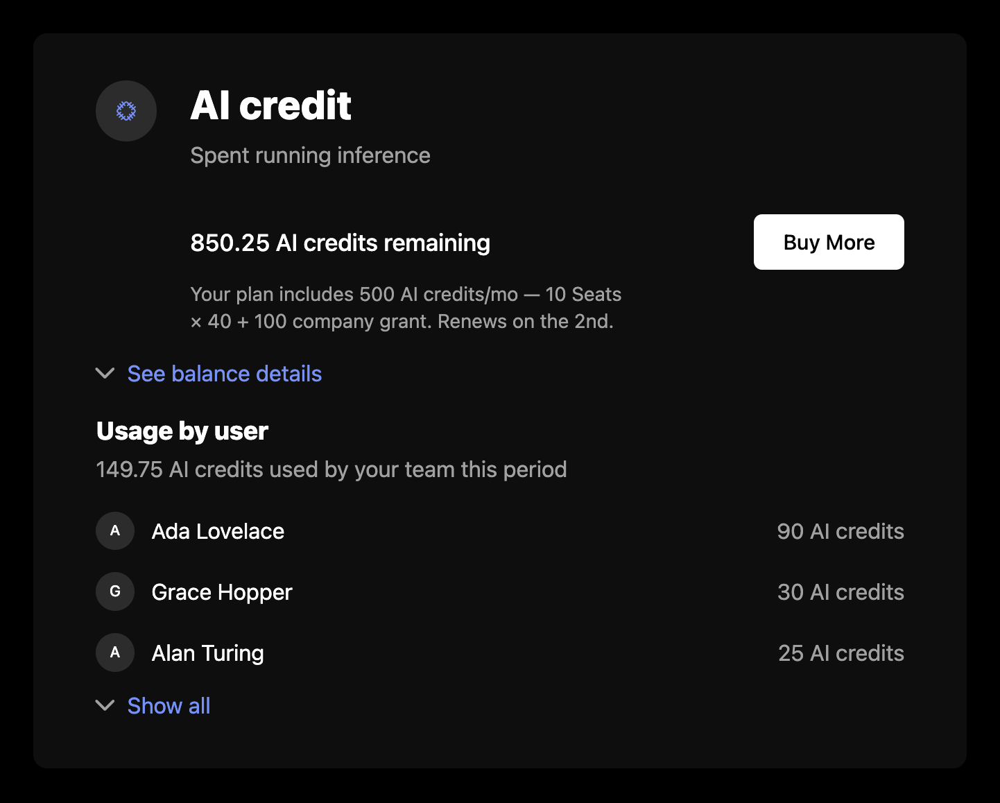

`CreditUsage` renders the signed-in company's credit balances as a card per credit: what is left, the grants behind it, how the plan's grants add up, and who on the team spent it. The cards load from the company billing API, so they need a `session` on the provider as described in the [Drop-in components overview](/components/drop-in/overview#the-session).



## Usage

```tsx
import { SchematicProvider } from "@schematichq/schematic-react";
import {
  CreditUsage,
  SchematicStyles,
} from "@schematichq/schematic-components/elements";

<SchematicProvider publishableKey={publishableKey} session={session}>
  <SchematicStyles />
  <CreditUsage onBuyMore={(credit) => openTopUp(credit.creditId)} />
</SchematicProvider>;
```

## Props

| Prop | Default | Effect |
| --- | --- | --- |
| `showHeader` | `false` | The "Credits" heading above the cards. |
| `showIcon` | `true` | Each credit's icon. The circle holds its place even when the credit has none. |
| `showDescription` | `true` | Each credit's description. |
| `showExpiration` | `true` | When each grant expires or resets, in its balance details. |
| `showUsage` | `true` | What is left of each credit. |
| `showUsageByUser` | `true` | The breakdown of consumption by user. |
| `visibleCredits` | | Credit ids to show, in this order. Every credit shows when it is absent. |
| `onBuyMore` | | "Buy More" calls this with the credit's balance entry. |
| `buyMoreUrl`, `buyMoreTarget` | | "Buy More" links here when there is no `onBuyMore`. |
| `headingLevel` | `2` | The heading's level, `1` through `6`. Each credit's name sits one level below while the heading shows, and takes the level itself when it does not. |
| `className` | | Added to the root alongside `schematic-element schematic-credit-usage`. |
| `locale` | | BCP 47 tag for number and date formatting. Falls back to the provider's `locale`, then the viewer's language. |
| `strings` | | Copy for this component by key. Wins over the provider's `strings` and `translate`. |

A company with no credits, on a plan that draws on none, renders nothing.

## Buy More

"Buy More" shows on a credit only when a bundle of it is on offer to the company's plan, and only when you give it somewhere to go with `onBuyMore` or `buyMoreUrl`. The component has no purchase flow of its own, so you decide whether the button opens your checkout, a dialog, or a page.

## Balance details

Each card shows the remaining balance, such as "3,100 AI credits remaining". When the plan grants the credit per license, a line under it shows the plan's total per period, the license count times the per-license amount that makes it up, any company grant on top, and the day it renews.

"See balance details" opens the ledger: the live grants behind the balance, newest first. Each grant names where it came from (included in the plan, a bundle purchase, an auto top-up, or a promotional grant) and when it resets or expires. The ledger shows three grants, then "See all" for the rest. The server leaves expired and zeroed-out grants out. A credit with no grants shows neither the ledger nor usage by user.

## Usage by user

Under the ledger, each credit lists who on the team spent it over the span of its live grants, heaviest first, with the team's total. It shows three people, then expands to the top 20 and reports the rest as a count. Usage sent without a user appears as "Unattributed" once the list is expanded. When this list fails to load, it shows its own message and "Try again" and the rest of the card stays.

## Errors

A failure with nothing to show replaces the content with a short message and a "Try again" button. A 404 reads "Credits are not available for this account.", because that status means the account is not enabled for the company billing endpoints. Every other failure, and a 404 under balances already loaded, reads "There was a problem retrieving your credits." A refetch that fails with balances on screen is reported under them rather than replacing them. In development the component logs the underlying error to the console beside the copy.

## Strings

Every word the component renders resolves through `strings` on the component, then on the provider, then the provider's `translate`, then English. See [Localization](/components/drop-in/localization) for how the chain works. These are the component's own keys:

| Key | Default |
| --- | --- |
| `creditUsageHeader` | Credits |
| `creditUsageLoading` | Loading credits, read by assistive technology while the skeleton shows |
| `creditUsageError` | There was a problem retrieving your credits. |
| `creditUsageUnavailable` | Credits are not available for this account. |
| `creditUsageRemaining` | `{{amount}} {{units}} remaining` |
| `creditUsageBuyMore` | Buy More |
| `creditUsageSeeDetails`, `creditUsageHideDetails` | See balance details, Hide balance details |
| `creditUsageSeeAll`, `creditUsageHideAll` | `See all ({{total}})`, Hide all |
| `creditUsageGrantPlan` | `{{amount}} {{item}} included in plan` |
| `creditUsageGrantBundle` | `{{amount}} {{item}} bundle purchased {{createdAt}}` |
| `creditUsageGrantAutoTopup` | `{{amount}} {{item}} auto-topup purchased {{createdAt}}` |
| `creditUsageGrantPromotional` | `{{amount}} promotional {{item}} granted {{createdAt}}` |
| `creditUsageResets`, `creditUsageExpires` | `Resets {{date}}`, `Expires {{date}}` |
| `creditUsageComposition` | `Your plan includes {{total}} {{creditName}}/{{period}} — {{perLicense}}.` |
| `creditUsageCompositionWithGrant` | `Your plan includes {{total}} {{creditName}}/{{period}} — {{perLicense}} + {{companyGrant}}.` |
| `creditUsagePerLicense` | `{{quantity}} {{licenseName}} × {{perUnit}}` |
| `creditUsageCompanyGrant` | `{{amount}} company grant` |
| `creditUsageRenewsOn` | `Renews on the {{day}}.` |
| `retry` | Try again |

The per-user list shares the `usageByUser*` keys with [Metered Features](/components/drop-in/metered-features#strings), and the composition line uses `periodMonthShort`, `periodQuarterShort`, and `periodYearShort` (mo, qtr, yr).

```tsx
<CreditUsage strings={{ creditUsageBuyMore: "Top up", creditUsageSeeDetails: "Show grants" }} />
```

## Markup

This is what the component renders, for a host styling it without `SchematicStyles`. The root carries no card styling of its own; each credit is a `schematic-card`. [Styling and theming](/components/drop-in/styling) lists the shared classes.

```html
<div class="schematic-element schematic-credit-usage" data-state="ready">
  <!-- with showHeader -->
  <div class="schematic-header">
    <h2 class="schematic-header__title">Credits</h2>
  </div>

  <div class="schematic-credit-usage__credits">
    <section class="schematic-card schematic-credit-usage__credit" aria-label="AI credits">
      <div class="schematic-credit-usage__main">
        <span class="schematic-credit-usage__icon">
          <!-- a schematic-icons glyph; an emoji renders as text in <i class="schematic-icon"> -->
          <i class="schematic-icon schematic-icon--…" aria-hidden="true"></i>
        </span>
        <div class="schematic-credit-usage__body">
          <div class="schematic-credit-usage__title">
            <h3 class="schematic-credit-usage__name">AI credits</h3>
            <p class="schematic-muted">…</p>
          </div>
          <div class="schematic-credit-usage__balance">
            <span class="schematic-credit-usage__remaining">3,100 AI credits remaining</span>
            <!-- a <button> with onBuyMore, an <a> with buyMoreUrl -->
            <button class="schematic-cta schematic-cta--small schematic-credit-usage__buy-more">Buy More</button>
          </div>
          <!-- a per-license plan grant -->
          <p class="schematic-muted schematic-small schematic-credit-usage__composition">…</p>
        </div>
      </div>

      <div class="schematic-credit-usage__ledger">
        <!-- while open -->
        <div class="schematic-credit-usage__grants">
          <ul class="schematic-credit-usage__grant-list">
            <li class="schematic-credit-usage__grant">
              <span class="schematic-credit-usage__grant-text">…</span>
              <span class="schematic-credit-usage__grant-date">Resets …</span>
            </li>
          </ul>
          <!-- more than three grants -->
          <button class="schematic-link-button schematic-credit-usage__see-all" aria-expanded="false">
            <i class="schematic-icon schematic-icon--chevron-down schematic-chevron" aria-hidden="true"></i>
            <span class="schematic-link-button__label">See all (5)</span>
          </button>
        </div>
        <button class="schematic-link-button schematic-credit-usage__details" aria-expanded="true">
          <i class="schematic-icon schematic-icon--chevron-up schematic-chevron" aria-hidden="true"></i>
          <span class="schematic-link-button__label">Hide balance details</span>
        </button>
      </div>

      <div class="schematic-usage-by-user">
        <span class="schematic-usage-by-user__title">Usage by user</span>
        <span class="schematic-muted">…</span>
        <ul class="schematic-usage-by-user__list">
          <li class="schematic-usage-by-user__user">
            <span class="schematic-usage-by-user__avatar" aria-hidden="true">A</span>
            <span class="schematic-usage-by-user__name">Ada</span>
            <span class="schematic-muted schematic-usage-by-user__amount">…</span>
          </li>
          <!-- expanded, usage no user claims: a "?" avatar and a muted name -->
          <li class="schematic-usage-by-user__user">
            <span class="schematic-usage-by-user__avatar" aria-hidden="true">?</span>
            <span class="schematic-usage-by-user__name schematic-muted">Unattributed</span>
            <span class="schematic-muted schematic-usage-by-user__amount">…</span>
          </li>
        </ul>
        <button class="schematic-link-button schematic-usage-by-user__toggle" aria-expanded="false">…</button>
      </div>
    </section>
  </div>
</div>
```

While loading, the root carries `data-state="pending"` and `aria-busy="true"`, with a visually hidden `schematic-hidden` loading label and a `schematic-skeleton`: a heading bar when `showHeader` is set, then two rows, each with a `name` and a `remaining` cell. On a failure with nothing to show, the root carries `data-state="error"` and holds a `schematic-status` row.

## Build it yourself

[`useCreditBalances`](/components/build-your-own/hooks#usecreditbalances) returns the balances with their grants, and `useCreditUserUsage(creditId)` returns one credit's usage by user. [`deriveCreditUsage`](/components/build-your-own/derivations) turns the balances into each credit's remaining amount, ledger rows by kind with their dates, and the plan composition.
