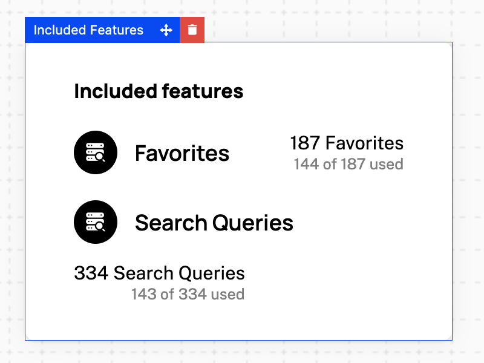

`IncludedFeatures` renders every feature the signed-in company is entitled to: what it gets, what it has used, and, for a priced feature, what that costs. The card loads from the company billing API, so it needs a `session` on the provider as described in the [Drop-in components overview](/components/drop-in/overview#the-session).



## Usage

```tsx
import { SchematicProvider } from "@schematichq/schematic-react";
import {
  IncludedFeatures,
  SchematicStyles,
} from "@schematichq/schematic-components/elements";

<SchematicProvider publishableKey={publishableKey} session={session}>
  <SchematicStyles />
  <IncludedFeatures visibleFeatures={["feat_api", "feat_seats"]} showHardLimit />
</SchematicProvider>;
```

## Props

| Prop | Default | Effect |
| --- | --- | --- |
| `showHeader` | `true` | The "Included features" heading. |
| `showIcon` | `true` | Each feature's icon, where it has one. |
| `showDescription` | `true` | Each feature's description. |
| `showExpiration` | `true` | When a company override ends. |
| `showEntitlement` | `true` | What the company gets: its allocation, price, or tier. |
| `showUsage` | `true` | What it has used, what that costs, and when it resets. |
| `visibleFeatures` | | Feature ids to show, in this order. Every feature shows when it is absent. |
| `showCredits` | `true` | The "credits per use" line on credit-burning features. |
| `showHardLimit` | `false` | An info tip with the hard limit on features billed past it. |
| `showWarningThresholdAsLimit` | `false` | The warning threshold in place of the limit, where one is set. |
| `headingLevel` | `2` | The heading's level, `1` through `6`, so the card fits your page's outline. |
| `className` | | Added to the root alongside `schematic-element schematic-card schematic-included-features`. |
| `locale` | | BCP 47 tag for number, currency, and date formatting. Falls back to the provider's `locale`, then the viewer's language. |
| `strings` | | Copy for this card by key. Wins over the provider's `strings` and `translate`. |

The first four features show, with "See all" for the rest. A company entitled to nothing gets the heading over an empty list; leave the component off the page if you would rather show nothing.

## How each row reads

Every row names the feature, with its description under it. A license feature adds a line for each per-license credit grant, such as "Includes 10 AI credits per Seat", and a company override adds when it expires.

Boolean and license features stop there. Event- and trait-based features add what the company gets on the right, by price behavior:

| Price behavior | Entitlement | Usage beneath it |
| --- | --- | --- |
| None | The limit, such as "2,000 API calls", or "Unlimited API calls" | When usage resets; without a reset date, "1,300 of 2,000 used" or "1,300 used" |
| Pay in advance | The quantity bought, such as "12 Seats" | The unit price per period, what it costs, and when it resets |
| Pay as you go | The unit or package price, such as "$0.01 per API call" | What is used, what it has cost, and when it resets |
| Overage | The included amount | What is used, what it has cost, and when it resets |
| Tiered | The current tier, such as "Up to 1,000 API calls in this tier" | What is used, what it costs, and when it resets, with a tooltip listing every tier's price |
| Credit burn | The credits each use costs, unless `showCredits` is off | What is used, what it has cost, and when it resets |

The usage segments join with a bullet, as in "1,300 API calls used • Resets Oct 1". A pay-in-advance feature with a tiered price reads like a tiered one beneath its quantity.

## Errors

A failure with nothing to show replaces the card's content with a short message and a "Try again" button. A 404 reads "Features are not available for this account.", because that status means the account is not enabled for the company billing endpoints. Every other failure, and a 404 under rows already loaded, reads "There was a problem retrieving your features." A refetch that fails with rows on screen is reported under them rather than replacing them. In development the component logs the underlying error to the console beside the copy.

## Strings

Every word the card renders resolves through `strings` on the component, then on the provider, then the provider's `translate`, then English. See [Localization](/components/drop-in/localization) for how the chain works. These are the card's own keys:

| Key | Default |
| --- | --- |
| `includedFeaturesHeader` | Included features |
| `includedFeaturesLoading` | Loading features, read by assistive technology while the skeleton shows |
| `includedFeaturesError` | There was a problem retrieving your features. |
| `includedFeaturesUnavailable` | Features are not available for this account. |
| `includedFeaturesSeeAll`, `includedFeaturesHideAll` | See all, Hide all |
| `includedFeaturesExpires` | `Expires {{date}}` |
| `includedFeaturesPerLicense` | `Includes {{amount}} {{creditName}} per {{licenseName}}` |
| `retry` | Try again |

The usage lines use these keys, shared in part with [Metered Features](/components/drop-in/metered-features#strings), [Plan Manager](/components/drop-in/plan-manager), and [Pricing Table](/components/drop-in/pricing-table), so renaming one renames it wherever it appears:

| Key | Default |
| --- | --- |
| `usageUnits` | `{{amount}} {{units}}` |
| `usagePerUnit`, `usagePerPackage` | `{{cost}} per {{unit}}`, `{{cost}} per {{size}} {{units}}` |
| `usageTierUpTo`, `usageTierUnlimited` | `Up to {{amount}} {{feature}} in this tier`, `Unlimited {{feature}} in this tier` |
| `usagePerUse` | `{{amount}} {{units}} per use` |
| `usageUnlimited` | `Unlimited {{item}}` |
| `usageUnitPricePerPeriod`, `usagePackagePricePerPeriod` | `{{cost}}/{{unit}}/{{period}}`, `{{cost}}/{{size}} {{units}}/{{period}}` |
| `usageUsed` | `{{amount}} {{units}} used` |
| `usageResets` | `Resets {{date}}` |
| `usageLimited`, `usageUnlimitedUsed` | `{{amount}} of {{allocation}} used`, `{{amount}} used` |
| `usageHardLimitLabel`, `usageHardLimit` | Limit, `Up to a limit of {{amount}} {{units}}` |
| `usageTieredPricingLabel` | Tiered pricing |
| `usageTiersVolume`, `usageTiersGraduated` | Price by unit based on final tier reached., Tiers apply progressively as quantity increases. |
| `periodMonthShort`, `periodQuarterShort`, `periodYearShort` | mo, qtr, yr |

## Markup

This is what the component renders, for a host styling it without `SchematicStyles`. The root's class list is the same in every state, and `data-state` tells them apart. [Styling and theming](/components/drop-in/styling) lists the shared classes.

```html
<div class="schematic-element schematic-card schematic-included-features" data-state="ready">
  <div class="schematic-header">
    <h2 class="schematic-header__title">Included features</h2>
  </div>

  <ul class="schematic-included-features__list">
    <li class="schematic-included-features__row">
      <!-- a feature with an icon -->
      <i class="schematic-icon schematic-icon--… schematic-included-features__icon" aria-hidden="true"></i>
      <div class="schematic-included-features__details">
        <span class="schematic-included-features__name">API calls</span>
        <!-- the description and per-license credit lines -->
        <span class="schematic-muted schematic-small">…</span>
        <!-- an override's expiry -->
        <em class="schematic-muted schematic-small">Expires Oct 1, 2026</em>
      </div>
      <!-- event- and trait-based features -->
      <div class="schematic-included-features__usage">
        <span class="schematic-included-features__entitlement">2,000 API calls</span>
        <span class="schematic-muted schematic-small schematic-included-features__used">1,300 API calls used • Resets Oct 1</span>
      </div>
    </li>
  </ul>

  <!-- more than four features -->
  <button class="schematic-link-button schematic-included-features__toggle" aria-expanded="false">
    <i class="schematic-icon schematic-icon--chevron-down schematic-chevron" aria-hidden="true"></i>
    <span class="schematic-link-button__label">See all</span>
  </button>
</div>
```

An icon that is not a schematic-icons glyph name, such as an emoji, renders as text inside `<i class="schematic-icon schematic-included-features__icon">`. The hard limit and the tiered prices render as a `schematic-tooltip`: a `schematic-tooltip__trigger` button with an info glyph, and the text in `schematic-tooltip__content`. The tiers fill it with a `schematic-tiers` block: a `schematic-tiers__list` `<dl>` of `schematic-tiers__tier` rows, each a `schematic-tiers__range` and a `schematic-tiers__price`, then the tiers mode in `schematic-tiers__mode`. While loading, the root carries `data-state="pending"` and `aria-busy="true"`, with a visually hidden `schematic-hidden` loading label and a `schematic-skeleton`: a heading bar when `showHeader` is set, then three rows, each with a `name` and a `usage` cell. On a failure with nothing to show, the root carries `data-state="error"` and holds a `schematic-status` row.

## Build it yourself

[`useFeatureUsage`](/components/build-your-own/hooks#usefeatureusage) returns every entitlement row, and [`deriveIncludedFeatures`](/components/build-your-own/derivations) turns each into its entitlement, usage segments, expiry, and per-license credit lines, with numbers, names, and dates already formatted.
