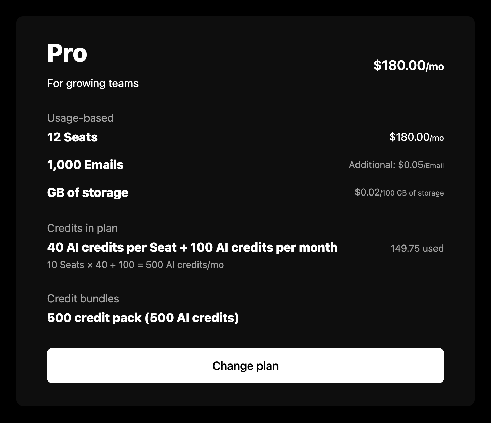

`PlanManager` renders the signed-in company's plan: a notice about where its subscription is headed, the plan and its price, its add-ons, its usage-based features, and the credits the plan and the company's purchases bring. It reads the company, its feature usage, and its credit balances from the company billing API, so it needs a `session` on the provider as described in the [Drop-in components overview](/components/drop-in/overview#the-session).



## Usage

```tsx
import { SchematicProvider } from "@schematichq/schematic-react";
import {
  PlanManager,
  SchematicStyles,
} from "@schematichq/schematic-components/elements";

<SchematicProvider publishableKey={publishableKey} session={session}>
  <SchematicStyles />
  <PlanManager changePlanUrl="/billing/plans" onEditAutoTopup={openTopUpSettings} />
</SchematicProvider>;
```

## Props

| Prop | Default | Effect |
| --- | --- | --- |
| `showNotice` | `true` | The notice above the plan. |
| `showHeader` | `true` | The plan's name, description, and price. |
| `showDescription` | `true` | The plan's description. |
| `showPrice` | `true` | The plan's price. |
| `showAddOns` | `true` | The add-ons the company holds. |
| `showUsageBased` | `true` | The usage-based features and their prices. |
| `showCredits` | `true` | Every credit section, and the credit-burning features under Usage-based. |
| `showLabels` | `true` | Each section's label. |
| `showZeroPriceAsFree` | `false` | A plan priced at zero with no usage-based features reads "Free". |
| `showHardLimit` | `false` | An info tip with the hard limit on features billed past it. |
| `showWarningThresholdAsLimit` | `false` | An entitlement's warning threshold in place of its limit, where one is set. |
| `onChangePlan` | | "Change plan" calls this. |
| `changePlanUrl`, `changePlanTarget` | | "Change plan" links here when there is no `onChangePlan`. |
| `onEditAutoTopup` | | "Edit" on the auto top-up settings calls this. |
| `editAutoTopupUrl`, `editAutoTopupTarget` | | "Edit" links here when there is no `onEditAutoTopup`. |
| `headingLevel` | `2` | The plan name's heading level, `1` through `6`. |
| `className` | | Added to the root alongside `schematic-element schematic-plan-manager`. |
| `locale` | | BCP 47 tag for number, currency, and date formatting. Falls back to the provider's `locale`, then the viewer's language. |
| `strings` | | Copy for this component by key. Wins over the provider's `strings` and `translate`. |

## Change plan and Edit

"Change plan" and the auto top-up "Edit" show only when you give them somewhere to go, with a handler or a URL. The component has no checkout of its own, so the button reaches whatever plan picker or purchase flow you point it at. "Change plan" also hides while a custom plan waits on payment to activate.

The card does not see what happens behind those buttons. When your handler changes the plan or the top-up settings without leaving the page, call the function [`useInvalidateBillingData`](/components/build-your-own/hooks#useinvalidatebillingdata) returns once it finishes, and every loaded resource reloads.

## Notices

At most one notice shows, in this order:

| Notice | Shows when | Reads |
| --- | --- | --- |
| Trial | The subscription is trialing and not set to cancel | "Trial ends in 5 days", counting down in whole days, then hours or minutes; "Trial ends in less than a minute"; "Your trial has ended" |
| Cancellation | The subscription is set to cancel at period end | "Subscription canceled", with the date access ends |
| Custom plan billing | A custom plan's invoice is pending | "Pay to activate" the plan, or "Pay by" its due date to keep it, with "Pay now" opening the invoice in a new tab |
| Scheduled downgrade | A downgrade is scheduled | "Downgrade to" the new plan, with the date access to the current one ends |

The notice carries its kind on `data-kind`: `trial`, `canceled`, `customPlanBilling`, or `scheduledDowngrade`.

## The plan and its sections

The price reads per the subscription's period, such as "$30.00/mo". A free plan with usage-based features reads "Usage-based", and a plan priced at zero reads "Free" only with `showZeroPriceAsFree`.

Under the plan, each section has a label you can hide with `showLabels`:

- Add-ons lists each held add-on at its price, per the plan's period, or once for a one-time add-on.
- Usage-based lists each feature with a price behavior: its limit or the quantity paid for, its unit or package price, its credits per use, and what an allocation paid in advance costs. Tiered features carry a tooltip with every tier's price.
- Credits in plan sums the plan's grants of each credit, worded per license where the plan grants per license, with how much is used. When the plan lets the company top up its credits, an auto top-up box follows with each credit's threshold and top-up amount, or that its auto top-up is disabled, and "Edit".
- Top-ups, Credit bundles, and Promotional credits list the company's auto top-up, purchased, and free grants, a row per bundle (or per grant outside one), newest first.

Each credit section shows three rows, then "See all" for the rest. `showCredits={false}` hides every credit section.

## Errors

A failure with nothing to show replaces the content with a short message and a "Try again" button. A 404 reads "Your plan is not available for this account.", because that status means the account is not enabled for the company billing endpoints. Every other failure, and a 404 under a plan already loaded, reads "There was a problem retrieving your plan." A refetch that fails with the plan on screen is reported under it rather than replacing it. In development the component logs the underlying error to the console beside the copy.

Credits that fail to load cost only the credit sections. The rest of the card renders, and a "There was a problem retrieving your credits." row with "Try again" stands in their place.

## Strings

Every word the component renders resolves through `strings` on the component, then on the provider, then the provider's `translate`, then English. See [Localization](/components/drop-in/localization) for how the chain works. These are the component's own keys:

| Key | Default |
| --- | --- |
| `planManagerLoading` | Loading your plan, read by assistive technology while the skeleton shows |
| `planManagerError`, `planManagerUnavailable` | There was a problem retrieving your plan.; Your plan is not available for this account. |
| `planManagerTrialEndsIn` | `Trial ends in {{amount}} {{units}}` |
| `planManagerTrialEndsSoon`, `planManagerTrialEnded` | Trial ends in less than a minute, Your trial has ended |
| `planManagerDays`, `planManagerHours`, `planManagerMinutes` | The countdown's units, each with `_one` and `_other` forms (day, days) |
| `planManagerCanceled` | Subscription canceled |
| `planManagerAccessEnds` | `Access to {{plan}} will end on {{date}}.` |
| `planManagerPlanFallback`, `planManagerYourPlan` | plan, your plan, used when the plan has no name |
| `planManagerCustomAwaiting` | `Pay to activate {{plan}}` |
| `planManagerCustomAwaitingDescription` | `Pay the invoice to activate your custom plan. Due by {{date}}.` |
| `planManagerCustomDue` | `Pay by {{date}} to keep {{plan}}` |
| `planManagerCustomDueDescription` | `Access to {{plan}} will end on {{date}} unless the invoice is paid.` |
| `planManagerPayNow` | Pay now |
| `planManagerDowngradeScheduled` | `Downgrade to {{plan}} scheduled` |
| `planManagerUsageBased`, `planManagerFree` | Usage-based, Free |
| `planManagerAddOns` | Add-ons |
| `planManagerAdditional`, `planManagerTierBased` | Additional, Tier-based |
| `planManagerCreditsInPlan`, `planManagerTopUps`, `planManagerCreditBundles`, `planManagerPromotionalCredits` | Credits in plan, Top-ups, Credit bundles, Promotional credits |
| `planManagerCreditsError`, `planManagerCreditsLoading` | There was a problem retrieving your credits.; Loading your credits |
| `planManagerCredits` | `{{amount}} {{creditName}}` |
| `planManagerCreditsPerPeriod` | `{{amount}} {{creditName}} per {{period}}` |
| `planManagerCreditsPerLicense` | `{{amount}} {{creditName}} per {{licenseName}}` |
| `planManagerCreditsPlusPerPeriod` | `+ {{amount}} {{creditName}} per {{period}}` |
| `planManagerLicensesTimesCredits` | `{{quantity}} {{licenseName}} × {{perUnit}} = {{total}} {{creditName}}/{{period}}` |
| `planManagerLicensesTimesCreditsPlusCompany` | `{{quantity}} {{licenseName}} × {{perUnit}} + {{fixed}} = {{total}} {{creditName}}/{{period}}` |
| `planManagerUsed` | `{{amount}} used` |
| `planManagerAutoTopup` | Auto top-up |
| `planManagerAutoTopupDisabled` | `Auto top-up disabled for {{unit}}` |
| `planManagerAutoTopupAdds` | `Adds {{amount}} {{unit}} when {{threshold}} remaining in balance` |
| `planManagerAutoTopupTip` | `When credit balance reaches {{threshold}} remaining, an auto top-up of {{amount}} credits will be processed.` |
| `planManagerEdit`, `planManagerChangePlan` | Edit, Change plan |
| `planManagerSeeAll`, `planManagerHideAll` | `See all ({{total}})`, Hide all |
| `retry` | Try again |

The usage-based rows share `usagePerUse`, `usageHardLimitLabel`, `usageHardLimit`, `usageTieredPricingLabel`, `usageTiersVolume`, and `usageTiersGraduated` with the usage components. Prices and the per-license breakdown under a credit take the `periodMonthShort`, `periodQuarterShort`, and `periodYearShort` suffixes, and the credit lines name the full period with `periodDay` through `periodYear`.

```tsx
<PlanManager strings={{ planManagerChangePlan: "See plans", planManagerAddOns: "Extras" }} />
```

## Markup

This is what the component renders, for a host styling it without `SchematicStyles`. The notice sits above the card, inside the root. [Styling and theming](/components/drop-in/styling) lists the shared classes.

```html
<div class="schematic-element schematic-plan-manager" data-state="ready">
  <div class="schematic-plan-manager__notice" data-kind="trial" role="status">
    <p class="schematic-plan-manager__notice-title">Trial ends in 5 days</p>
    <!-- cancellation, custom plan billing, and downgrade notices -->
    <p class="schematic-small schematic-plan-manager__notice-body">…</p>
    <!-- custom plan billing with an invoice -->
    <a class="schematic-cta schematic-plan-manager__pay-now" href="…" target="_blank" rel="noreferrer">Pay now</a>
  </div>

  <div class="schematic-card schematic-plan-manager__card">
    <div class="schematic-plan-manager__plan">
      <div class="schematic-plan-manager__title">
        <h2 class="schematic-plan-manager__name">Starter</h2>
        <p class="schematic-plan-manager__description">…</p>
      </div>
      <div class="schematic-plan-manager__price">$30.00<sub>/mo</sub></div>
    </div>

    <section class="schematic-plan-manager__section" aria-label="Add-ons">
      <span class="schematic-muted schematic-plan-manager__label">Add-ons</span>
      <ul class="schematic-plan-manager__rows">
        <li class="schematic-plan-manager__row">
          <span class="schematic-plan-manager__item">Single sign-on</span>
          <span class="schematic-plan-manager__price-value">$15.00<sub>/mo</sub></span>
        </li>
      </ul>
    </section>

    <!-- Usage-based rows put their price in .schematic-plan-manager__detail -->

    <section class="schematic-plan-manager__section" aria-label="Credits in plan">
      <span class="schematic-muted schematic-plan-manager__label">Credits in plan</span>
      <ul class="schematic-plan-manager__rows">
        <li class="schematic-plan-manager__row schematic-plan-manager__row--stacked">
          <div class="schematic-plan-manager__row-main">
            <span class="schematic-plan-manager__item">1,000 AI credits per month</span>
            <span class="schematic-muted schematic-small schematic-plan-manager__used">400 used</span>
          </div>
          <!-- a per-license grant -->
          <span class="schematic-muted schematic-small">12 Seats × 10 + 100 = 220 AI credits/mo</span>
        </li>
      </ul>
      <!-- more than three rows -->
      <button class="schematic-link-button schematic-plan-manager__see-all" aria-expanded="false">
        <i class="schematic-icon schematic-icon--chevron-down schematic-chevron" aria-hidden="true"></i>
        <span class="schematic-link-button__label">See all (4)</span>
      </button>
      <div class="schematic-plan-manager__auto-topup">
        <div class="schematic-plan-manager__auto-topup-lines">
          <span class="schematic-plan-manager__item">Auto top-up</span>
          <span>…</span>
        </div>
        <button class="schematic-cta schematic-cta--small schematic-cta--ghost schematic-plan-manager__edit">Edit</button>
      </div>
    </section>

    <!-- Top-ups, Credit bundles, and Promotional credits: sections of plain
         .schematic-plan-manager__row items, an item and its __used figure -->

    <!-- a <button> with onChangePlan, an <a> with changePlanUrl -->
    <a class="schematic-cta schematic-plan-manager__change-plan" href="/billing/plans">Change plan</a>
  </div>
</div>
```

While loading, the root carries `data-state="pending"` and `aria-busy="true"`, with a visually hidden `schematic-hidden` loading label and a `schematic-skeleton` with a heading bar and two rows, each with a `name` and a `price` cell. On a failure with nothing to show, the root carries `data-state="error"` and holds a `schematic-status` row.

## Build it yourself

[`useCompany`](/components/build-your-own/hooks#usecompany) returns the plan, add-ons, subscription state, scheduled downgrade, and pending custom plan billing. With [`useFeatureUsage`](/components/build-your-own/hooks#usefeatureusage) and [`useCreditBalances`](/components/build-your-own/hooks#usecreditbalances), [`derivePlanManager`](/components/build-your-own/derivations#plan-manager) turns them into the notice, the plan and its price, the add-ons, the usage-based rows, and the credit sections.
