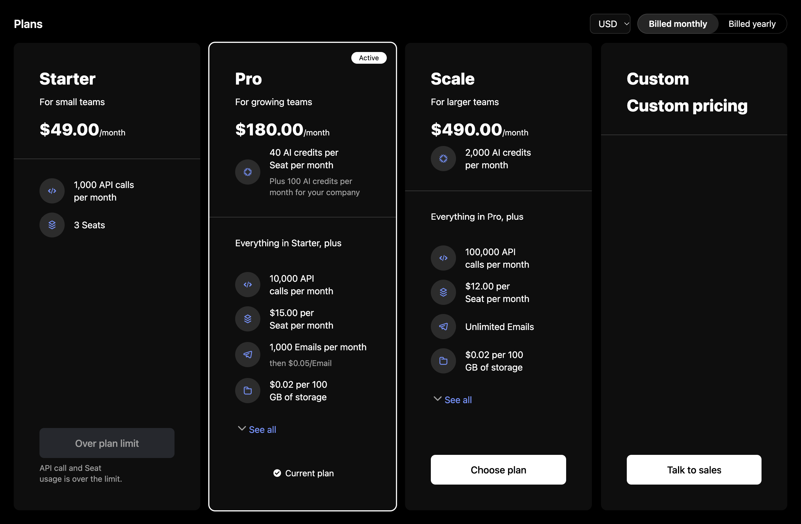

Plans and add-ons with a period toggle, a currency picker, included credits, and entitlement summaries. On a page nobody has signed in to it needs only your publishable key. Signed in, it marks the company's current plan and holds back the plans the company cannot move to. The table opens nothing itself: each card's action calls `onSelectPlan`, which can open [Checkout](/components/drop-in/checkout) or send a visitor to sign up.



## Usage

<Tabs>
  <Tab title="Public page">
```tsx
import { SchematicProvider } from "@schematichq/schematic-react";
import { PricingTable, SchematicStyles } from "@schematichq/schematic-components/elements";

<SchematicProvider publishableKey="pk_…">
  <SchematicStyles />
  <PricingTable
    onSelectPlan={({ id, period }) => router.push(`/signup?plan=${id}&period=${period ?? ""}`)}
  />
</SchematicProvider>
```
  </Tab>
  <Tab title="In the portal">
```tsx
import { SchematicProvider } from "@schematichq/schematic-react";
import {
  CheckoutLauncherProvider,
  PricingTable,
  SchematicStyles,
  useCheckoutLauncher,
} from "@schematichq/schematic-components/elements";

<SchematicProvider publishableKey={publishableKey} session={session}>
  <SchematicStyles />
  <CheckoutLauncherProvider>
    <Plans />
  </CheckoutLauncherProvider>
</SchematicProvider>;

function Plans() {
  const { open } = useCheckoutLauncher();
  return (
    <PricingTable
      onSelectPlan={(selection) => open({ selection: selection.checkout })}
    />
  );
}
```
  </Tab>
</Tabs>

## Props

| Prop | Default | Effect |
| --- | --- | --- |
| `catalogId` | | The catalog to show; the environment's when absent. |
| `onSelectPlan` | | A card's action calls this with the selection. |
| `callToActionUrl`, `callToActionTarget` | | A card's action links here when there is no `onSelectPlan`. |
| `period`, `defaultPeriod` | | The period shown, `month`, `quarter`, or `year`, controlled or initial. |
| `onPeriodChange` | | Called when the reader picks a period. |
| `currency`, `defaultCurrency` | | The currency shown, lowercase, controlled or initial. |
| `onCurrencyChange` | | Called when the reader picks a currency. |
| `showHeader` | `true` | "Plans" and "Add-ons" above their cards. |
| `showPlans` | `true` | The plans and the custom plan. |
| `showAddOns` | `true` | The add-ons. |
| `showPeriodToggle` | `true` | The period toggle, when there is more than one period. Signed in, a longer period that saves on the current plan carries a tip saying how much. |
| `showCurrencySelector` | `true` | The currency picker, when there is more than one currency. |
| `showDescription` | `true` | Each card's description. |
| `showEntitlements` | `true` | Each card's features. |
| `showFeatureIcons` | `true` | Each feature's and credit's icon. |
| `showFeatureDescriptions` | `false` | Each feature's description. |
| `showInclusionText` | `true` | `Everything in {{plan}}, plus` above each plan's features but the first. |
| `showCredits` | `true` | Each plan's included credits, and the credits per use on its features. |
| `showZeroPriceAsFree` | `false` | A plan priced at zero with no usage-based features reads "Free". |
| `showHardLimit` | `false` | An info tip with the hard limit on features billed past it. |
| `showWarningThresholdAsLimit` | `false` | An entitlement's warning threshold in place of its limit. |
| `headingLevel` | `2` | The level of "Plans" and "Add-ons"; card names sit one below. |
| `className`, `locale` | | Class added to the root, beside `schematic-element schematic-pricing-table`; BCP 47 tag for formatting. |
| `strings` | | Copy for this table by key; wins over the provider's. |

`onSelectPlan` receives the card the reader chose, priced as it was shown:

```ts
interface PricingTableSelection {
  kind: "plan" | "addOn";
  action: "choose" | "remove" | "change";      // what the card offered
  id: string;                                  // the plan's or add-on's id
  priceId: string | null;                      // the price the card shows
  period: "month" | "quarter" | "year" | null; // null for a one-time add-on
  currency: string;
  trialDays: number | null;                    // a trial the plan offers
  checkout: CheckoutSelection;                 // the cart to open Checkout with
}
```

`checkout` is the selection [Checkout](/components/drop-in/checkout) starts from: the plan with its period and currency, or the company's add-ons with this one added, removed or kept. `priceId` and `trialDays` describe the card; the checkout prices the cart itself and offers the trial when the company can take it.

Without `onSelectPlan`, `callToActionUrl` makes each action a link; without either, cards have no action apart from the two links that follow. The custom plan links to the catalog's own URL, and a blocked downgrade to the account's. Each card shows four features before "See all". A plan's included credits read a line per credit, such as "10 AI credits per Seat per month", and a credit the plan also grants the company outright adds that share beneath it: "Plus 100 AI credits per month for your company". When `onSelectPlan` opens a checkout that changes the plan without leaving the page, call the function [`useInvalidateBillingData`](/components/build-your-own/hooks#useinvalidatebillingdata) returns once it is done, and the table reloads with the new current plan.

## Public and company modes

The table reads the catalog through [`useCatalog`](/components/build-your-own/hooks#usecatalog), which follows the session on the provider. With no session, or before your auth resolves, it reads the public catalog with the provider's publishable key: plans, add-ons, and prices, with no customer data, and every plan's action is "Choose plan" and every add-on's "Choose add-on". Once a session starts it swaps to the company's view of the same catalog, which says which plan is current and which changes the purchase rules allow.

In company mode the table also reads the company, for the period its subscription bills in: the table opens on that period, and the current plan is marked current only in it. A company that fails to load costs only that. Each card's action follows the company's standing:

| Action | Shows when |
| --- | --- |
| "Current plan" | The company's plan in the period shown. No button. |
| "Choose plan", "Choose add-on" | Any other plan or add-on. A plan is filled above the current plan and outlined below it. |
| "Remove add-on", "Change add-on" | An add-on the company holds, in this period or another, respectively. |
| "Over plan limit" | The company's usage is over a limit the plan would set. Disabled, with the features named. |
| The account's downgrade text, else "Talk to support" | A downgrade the account does not allow in self-service. Links to the account's URL. |
| Disabled "Choose plan" or "Choose add-on" | The company cannot check out. |

In either mode, a card with prices but none in the selected currency is left out, and a recurring one with none in the selected period. The period toggle offers only the periods the catalog prices, months before quarters before years, and a one-time add-on is priced once.

With nothing to show, the table replaces the content with a message and "Try again": a 404 reads "Plans are not available for this account.", because that status means the account is not enabled for catalogs or `catalogId` names no catalog of the account's, and every other failure reads "Plans could not be loaded." A refetch that fails with plans on screen is reported under them as "Plans could not be loaded."

Server-rendered, prefetch with `fetchBillingData(client, { names: billingResources(PricingTable) })`, adding `catalog: { catalogId }` when the table sets `catalogId` so the seed matches the catalog it asks for. A resource the client cannot read, the company's view with no session or the public catalog with no key, is left out rather than failing the page.

## Markup

This is what the component renders, for a host styling it without `SchematicStyles`. [Styling and theming](/components/drop-in/styling) lists the shared classes.

```html
<div class="schematic-element schematic-pricing-table" data-state="ready">
  <section class="schematic-pricing-table__section">
    <div class="schematic-pricing-table__header">
      <h2 class="schematic-pricing-table__heading">Plans</h2>
      <div class="schematic-pricing-table__controls">
        <select class="schematic-select" aria-label="Currency">…</select>
        <div class="schematic-toggle" role="group" aria-label="Billing period">
          <button class="schematic-toggle__option" aria-pressed="true">Billed monthly</button>
          <!-- a longer period that saves on the current plan -->
          <span class="schematic-toggle__tip">
            <button class="schematic-toggle__option" aria-pressed="false">Billed yearly</button>
            <span class="schematic-tooltip__content schematic-toggle__tip-content" role="tooltip">Save up to 16.67% with yearly billing</span>
          </span>
        </div>
      </div>
    </div>
    <ul class="schematic-pricing-table__plans" aria-label="Plans">
      <li class="schematic-card schematic-plan-card schematic-plan-card--active" data-plan-id="plan_…">
        <div class="schematic-plan-card__header">
          <h3 class="schematic-plan-card__name">Starter</h3>
          <p class="schematic-plan-card__description">…</p>
          <div class="schematic-plan-card__price">$30.00<sub class="schematic-plan-card__period">/month</sub></div>
          <ul class="schematic-plan-card__credits">
            <li class="schematic-plan-card__credit">
              <i class="schematic-icon schematic-icon--… schematic-plan-card__icon" aria-hidden="true"></i>
              <div class="schematic-plan-card__feature">
                <span class="schematic-plan-card__feature-text">10 AI credits per Seat per month</span>
                <span class="schematic-muted schematic-plan-card__detail">Plus 100 AI credits per month for your company</span>
              </div>
            </li>
          </ul>
          <span class="schematic-badge schematic-plan-card__badge">Active</span>
        </div>
        <div class="schematic-plan-card__body">
          <div class="schematic-plan-card__features">
            <ul class="schematic-plan-card__entitlements" id="…">
              <li class="schematic-plan-card__inclusion">Everything in Free, plus</li>
              <li class="schematic-plan-card__entitlement">…</li>
            </ul>
            <button class="schematic-link-button schematic-plan-card__show-all" aria-expanded="false" aria-controls="…">…</button>
          </div>
          <div class="schematic-plan-card__current">
            <i class="schematic-icon schematic-icon--check-rounded schematic-plan-card__check" aria-hidden="true"></i>
            Current plan
          </div>
        </div>
      </li>
      <li class="schematic-card schematic-plan-card schematic-plan-card--custom">…</li>
    </ul>
  </section>
  <section class="schematic-pricing-table__section">
    <h2 class="schematic-pricing-table__heading">Add-ons</h2>
    <ul class="schematic-pricing-table__plans" aria-label="Add-ons">…</ul>
  </section>
</div>
```

Every other card ends in a `schematic-plan-card__action` holding a `schematic-cta` button, or a link with `callToActionUrl`; a downgrade or a change of add-on adds `schematic-cta--outline`, and removing an add-on adds `schematic-cta--ghost`. Under "Over plan limit" a `schematic-plan-card__violations` line names the features, as in "API calls and Seats usage is over the limit." Each entitlement is a `schematic-plan-card__feature` like the credit's, with its price detail in `schematic-plan-card__detail` and, with `showFeatureDescriptions`, its description in `schematic-plan-card__feature-description`. An icon that is not a schematic-icons glyph name, such as an emoji, renders as text inside `<i class="schematic-icon schematic-plan-card__icon">`. While loading, the root carries `data-state="pending"` and `aria-busy="true"` with a `schematic-skeleton`; on a failure with nothing to show, `data-state="error"` and a `schematic-status` row.

## Localizing it

The table's copy is under `pricingTable*`: `pricingTableLoading`, `pricingTablePlans`, `pricingTableAddOns`, `pricingTableCurrency`, `pricingTablePeriod`, `pricingTableBilledMonthly`, `pricingTableBilledQuarterly`, `pricingTableBilledYearly`, `pricingTableSaveQuarterly`, `pricingTableSaveYearly`, `pricingTableSavingQuarterly`, `pricingTableSavingYearly`, `pricingTableChoosePlan`, `pricingTableChooseAddOn`, `pricingTableChangeAddOn`, `pricingTableRemoveAddOn`, `pricingTableCurrentPlan`, `pricingTableOverLimit`, `pricingTableOverLimitDetail`, `pricingTableTalkToSupport`, `pricingTableActive`, `pricingTableTrialLeft`, `pricingTableUsageBased`, `pricingTableFree`, `pricingTableCustomPlan`, `pricingTableCustomPrice`, `pricingTableEverythingIn`, `pricingTableSeeAll`, `pricingTableHideAll`, `pricingTableCredits`, `pricingTableCreditsPerPeriod`, `pricingTableCreditsPerLicense`, `pricingTableCreditsPerLicensePerPeriod`, `pricingTableCreditsPlus`, `pricingTableCreditsPlusPerPeriod`, `pricingTableUnitsPerPeriod`, `pricingTablePerUnitPerPeriod`, `pricingTablePerPackagePerPeriod`, `pricingTablePerUse`, `pricingTableUpTo`, `pricingTableUpToPerPeriod`, `pricingTableTierBased`, `pricingTableThen`, `pricingTableError`, and `pricingTableUnavailable`. It shares `usageUnits`, `usagePerUnit`, `usagePerPackage`, `usageUnlimited`, and the tier and hard-limit tips with the usage components, the period names `periodDay` through `periodYear`, the suffixes `periodMonthShort`, `periodQuarterShort`, and `periodYearShort`, and `retry`. See [Localization](/components/drop-in/localization) for how the chain works.

## Build it yourself

[`useCatalog`](/components/build-your-own/hooks#usecatalog) returns the catalog in either mode, tagged with its `source`. [`derivePricingTable`](/components/build-your-own/derivations#pricing-table) takes your period and currency selection, and the company when signed in, and returns the periods and currencies on offer, a card per plan and add-on with its price and action, and the custom plan. The [pricing page recipe](/components/build-your-own/recipes#pricing-page) puts them together.
