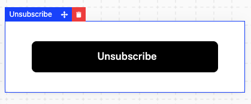

`UnsubscribeButton` cancels the signed-in company's subscription at the end of its billing period. It opens a confirmation first, which says when access ends and what the subscription costs today. It reads the company and its feature usage from the company billing API, so it needs a `session` on the provider as described in the [Drop-in components overview](/components/drop-in/overview#the-session).



## Usage

```tsx
import { SchematicProvider } from "@schematichq/schematic-react";
import {
  SchematicStyles,
  UnsubscribeButton,
} from "@schematichq/schematic-components/elements";

<SchematicProvider publishableKey={publishableKey} session={session}>
  <SchematicStyles />
  <UnsubscribeButton managePlanUrl="/billing/plans" onUnsubscribed={showGoodbye} />
</SchematicProvider>;
```

## Props

| Prop | Default | Effect |
| --- | --- | --- |
| `onManagePlan` | | "Manage plan" in the confirmation calls this. |
| `managePlanUrl`, `managePlanTarget` | | "Manage plan" links here when there is no `onManagePlan`. |
| `onUnsubscribed` | | Called once the subscription is set to cancel. |
| `className` | | Added to the root alongside `schematic-element schematic-card schematic-unsubscribe`. |
| `locale` | | BCP 47 tag for currency and date formatting. Falls back to the provider's `locale`, then the viewer's language. |
| `strings` | | Copy for the button and its confirmation by key. Wins over the provider's `strings` and `translate`. |

## When it shows

The button renders nothing until the company and its feature usage load. It shows when the company has a subscription with no cancellation date, and renders nothing once the subscription is already set to cancel, so it disappears after a successful cancellation.

## The confirmation

"Unsubscribe" opens a modal titled "Cancel subscription", closed by Escape, the backdrop, or the control in its header. It says the company keeps access until the end of the billing period and names the date: the scheduled cancellation date, else the next bill date. Beside that it lists the plan and its price, each add-on that has a price, and the recurring total for the subscription's period, which counts the plan, recurring add-ons, and everything paid in advance. One-time add-ons are listed but left out of the total.

"Not ready to cancel?" and "Manage plan" show only when you pass `onManagePlan` or `managePlanUrl`, so you decide where a customer who changes their mind goes.

"Cancel subscription" sends the cancellation through [`useUnsubscribe`](/components/build-your-own/hooks#useunsubscribe), which sets the subscription to cancel at period end and refetches whichever of the company, upcoming invoice, and credit balances are already loaded. A [Plan Manager](/components/drop-in/plan-manager) on the same page then shows its cancellation notice. On success the dialog closes and `onUnsubscribed` runs. A failed cancellation shows "Unsubscribe failed" and leaves the confirmation open; the server's reason stays on the hook's `mutationError`. The server refuses with a 400 when the company has no subscription, when the subscription is already set to cancel, or when another Stripe app manages it.

## Errors

When the company or its usage fails to load, the component shows a short message and a "Try again" button in place of the button. A 404 reads "Your subscription is not available for this account.", because that status means the account is not enabled for the company billing endpoints. Every other failure reads "There was a problem retrieving your subscription." In development the component logs the underlying error to the console beside the copy.

## Strings

Every word the component renders resolves through `strings` on the component, then on the provider, then the provider's `translate`, then English. See [Localization](/components/drop-in/localization) for how the chain works. These are the keys:

| Key | Default |
| --- | --- |
| `unsubscribeButton` | Unsubscribe |
| `unsubscribeTitle` | Cancel subscription |
| `unsubscribeAccessUntil` | `You will retain access to your plan until the end of the billing period, on {{date}}` |
| `unsubscribeNotReady`, `unsubscribeManagePlan` | Not ready to cancel?, Manage plan |
| `unsubscribePlan`, `unsubscribeAddOns` | Plan, Add-ons |
| `unsubscribeMonthlyTotal`, `unsubscribeQuarterlyTotal`, `unsubscribeYearlyTotal` | Monthly total:, Quarterly total:, Yearly total: |
| `unsubscribeConfirm` | Cancel subscription |
| `unsubscribeFailed` | Unsubscribe failed |
| `unsubscribeClose` | Close, the dialog close control's accessible name |
| `unsubscribeError` | There was a problem retrieving your subscription. |
| `unsubscribeUnavailable` | Your subscription is not available for this account. |
| `retry` | Try again |

Prices carry the `periodMonthShort`, `periodQuarterShort`, and `periodYearShort` suffixes (mo, qtr, yr).

```tsx
<UnsubscribeButton strings={{ unsubscribeButton: "Cancel plan" }} />
```

## Markup

This is what the component renders, for a host styling it without `SchematicStyles`. The dialog renders inside the root while it is open. [Styling and theming](/components/drop-in/styling) lists the shared classes.

```html
<div class="schematic-element schematic-card schematic-unsubscribe">
  <button class="schematic-cta schematic-unsubscribe__open">Unsubscribe</button>

  <!-- while open -->
  <dialog class="schematic-dialog schematic-unsubscribe__dialog" aria-labelledby="…" open>
    <div class="schematic-dialog__header">
      <h2 class="schematic-dialog__title" id="…">Cancel subscription</h2>
      <button class="schematic-dialog__close" aria-label="Close">
        <i class="schematic-icon schematic-icon--close" aria-hidden="true"></i>
      </button>
    </div>
    <div class="schematic-dialog__body">
      <div class="schematic-unsubscribe__columns">
        <div class="schematic-unsubscribe__summary">
          <p>You will retain access to your plan until the end of the billing period, on …</p>
          <!-- with onManagePlan (a <button>) or managePlanUrl (an <a>) -->
          <div class="schematic-unsubscribe__manage">
            <p>Not ready to cancel?</p>
            <a class="schematic-cta schematic-cta--small schematic-cta--ghost schematic-unsubscribe__manage-plan" href="…">Manage plan</a>
          </div>
        </div>
        <div class="schematic-unsubscribe__sidebar">
          <div class="schematic-unsubscribe__group">
            <span class="schematic-muted schematic-small">Plan</span>
            <div class="schematic-unsubscribe__line">
              <span class="schematic-unsubscribe__name">Starter</span>
              <span>$30.00<sub>/mo</sub></span>
            </div>
          </div>
          <!-- an Add-ons group of the same shape when the company holds any -->
          <div class="schematic-unsubscribe__line schematic-unsubscribe__total">
            <span class="schematic-muted">Monthly total:</span>
            <span>$45.00<sub>/mo</sub></span>
          </div>
          <button class="schematic-cta schematic-unsubscribe__confirm">Cancel subscription</button>
          <!-- a failed cancellation -->
          <p class="schematic-error" role="alert">Unsubscribe failed</p>
        </div>
      </div>
    </div>
  </dialog>
</div>
```

On a failed read, the root carries `data-state="error"` and holds a `schematic-status` row with the message and the retry.

## Build it yourself

[`useUnsubscribe`](/components/build-your-own/hooks#useunsubscribe) returns `unsubscribe`, `isMutating`, and `mutationError`. [`useCompany`](/components/build-your-own/hooks#usecompany) has the subscription and its cancellation date, and [`deriveUnsubscribe`](/components/build-your-own/derivations) turns the company and its feature usage into whether there is a subscription to cancel, when access ends, and the plan, add-ons, and total.
