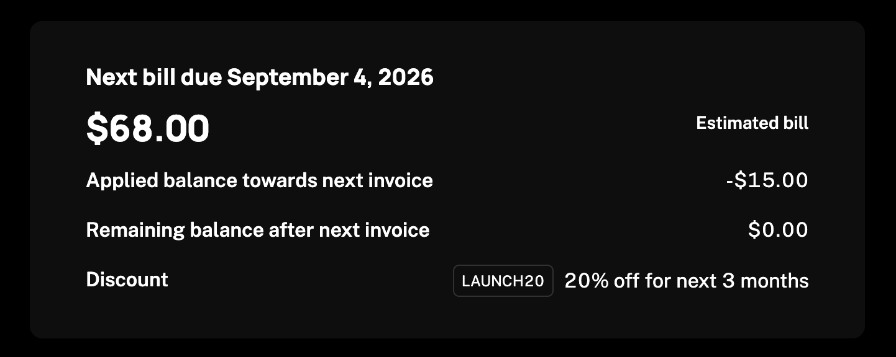

`UpcomingBill` renders the signed-in company's next bill: what it will be charged and when, with the account balance and discounts that shaped the figure. The card loads from the company billing API, so it needs a `session` on the provider as described in the [Drop-in components overview](/components/drop-in/overview#the-session).



## Usage

```tsx
import { SchematicProvider } from "@schematichq/schematic-react";
import {
  SchematicStyles,
  UpcomingBill,
} from "@schematichq/schematic-components/elements";

<SchematicProvider publishableKey={publishableKey} session={session}>
  <SchematicStyles />
  <UpcomingBill showDiscounts={false} />
</SchematicProvider>;
```

## Props

| Prop | Default | Effect |
| --- | --- | --- |
| `showHeader` | `true` | The "Next bill due …" heading. |
| `showAmount` | `true` | The estimated amount. |
| `showBalance` | `true` | The applied and remaining balance rows. |
| `showDiscounts` | `true` | The discount row, one line per active discount. |
| `headingLevel` | `2` | The heading's level, `1` through `6`, so the card fits your page's outline. |
| `className` | | Added to the root alongside `schematic-element schematic-card schematic-upcoming-bill`. |
| `locale` | | BCP 47 tag for currency and date formatting. Falls back to the provider's `locale`, then the viewer's language. |
| `strings` | | Copy for this card by key. Wins over the provider's `strings` and `translate`. |

## What the card shows

The heading names the due date, and drops out for a bill the billing provider has not dated. The amount sits beside an "Estimated bill" caption.

The applied balance row shows when this bill draws on the account balance, and the remaining balance row shows whenever there is a balance. A company that spends its whole balance on this bill still sees a remaining row reading zero, while a company with no balance sees neither. The server sends both figures, because they depend on billing-provider conventions, and the component signs the applied balance since it comes off the bill.

Every active discount lists under one "Discount" label with its promo code as a chip, or with no chip when the coupon has none. A repeating discount says how long it lasts, as in "20% off for next 3 months".

When there is nothing to bill, such as before a first subscription or for a trial that will cancel, the card reads "No upcoming invoice". That is a loaded answer from the server, so the card settles rather than holding its skeleton. A paid subscription set to cancel at period end is not that case: the billing provider still previews a dated bill, so the card shows the date and $0.00 until the period ends.

## Errors

A failure with nothing to show replaces the card's content with a short message and a "Try again" button. A 404 reads "Your upcoming invoice is not available for this account.", because that status means the bill cannot be read, such as when the account is not enabled for the company billing endpoints or the subscription has ended. Every other failure, and a 404 under a bill already loaded, reads "There was a problem retrieving your upcoming invoice." A refetch that fails with a bill on screen is reported under it rather than replacing it.

Neither message is the error's own text. In development the component logs the underlying error to the console beside the copy.

## Strings

Every word the card renders resolves through `strings` on the component, then on the provider, then the provider's `translate`, then English. See [Localization](/components/drop-in/localization) for how the chain works. These are the keys:

| Key | Default |
| --- | --- |
| `upcomingBillHeader` | `Next bill due {{date}}` |
| `upcomingBillLoading` | Loading your next bill, read by assistive technology while the skeleton shows |
| `upcomingBillEmpty` | No upcoming invoice |
| `upcomingBillError` | There was a problem retrieving your upcoming invoice. |
| `upcomingBillUnavailable` | Your upcoming invoice is not available for this account. |
| `upcomingBillEstimate` | Estimated bill |
| `upcomingBillBalanceApplied` | Applied balance towards next invoice |
| `upcomingBillBalanceRemaining` | Remaining balance after next invoice |
| `upcomingBillDiscount` | Discount |
| `upcomingBillDiscountValue` | `{{value}} off` |
| `upcomingBillDiscountRepeating` | `{{value}} off for next {{count}} months`, with `_one` and `_other` forms |
| `retry` | Try again |

```tsx
<UpcomingBill strings={{ upcomingBillEstimate: "Estimate" }} />
```

## Markup

This is what the component renders, for a host styling it without `SchematicStyles`. The root's class list is the same in every state, and `data-state` tells them apart. [Styling and theming](/components/drop-in/styling) lists the shared classes.

```html
<div class="schematic-element schematic-card schematic-upcoming-bill" data-state="ready">
  <!-- omitted for a bill with no due date -->
  <div class="schematic-header">
    <h2 class="schematic-header__title">Next bill due September 30, 2026</h2>
  </div>

  <div class="schematic-upcoming-bill__amount">
    <span class="schematic-upcoming-bill__total">$68.00</span>
    <span class="schematic-small schematic-upcoming-bill__estimate">Estimated bill</span>
  </div>

  <!-- omitted when there is no balance and no discount -->
  <div class="schematic-upcoming-bill__rows">
    <div class="schematic-row schematic-upcoming-bill__balance-applied">
      <span class="schematic-row__label">Applied balance towards next invoice</span>
      <span class="schematic-row__value">-$15.00</span>
    </div>
    <div class="schematic-row schematic-upcoming-bill__balance-remaining">
      <span class="schematic-row__label">Remaining balance after next invoice</span>
      <span class="schematic-row__value">$0.00</span>
    </div>
    <div class="schematic-row schematic-upcoming-bill__discount-row">
      <span class="schematic-row__label">Discount</span>
      <ul class="schematic-row__value schematic-upcoming-bill__discounts">
        <li class="schematic-upcoming-bill__discount">
          <!-- omitted for a coupon with no promo code -->
          <span class="schematic-chip schematic-upcoming-bill__code">LAUNCH20</span>
          <span class="schematic-upcoming-bill__discount-value">20% off for next 3 months</span>
        </li>
      </ul>
    </div>
  </div>

  <!-- with nothing to bill, in place of everything above -->
  <p class="schematic-muted schematic-upcoming-bill__empty">No upcoming invoice</p>

  <!-- a failure with the bill still on screen -->
  <p class="schematic-status-note schematic-error" role="alert">…</p>
</div>
```

While loading, the root carries `data-state="pending"` and `aria-busy="true"`, with a visually hidden `schematic-hidden` loading label and a `schematic-skeleton`: a heading bar when `showHeader` is set, then an `amount` cell and a `row` cell on their own rows. On a failure with nothing to show, the root carries `data-state="error"` and holds a `schematic-status` row.

## Build it yourself

[`useUpcomingInvoice`](/components/build-your-own/hooks#useupcominginvoice) returns the bill, or `null` when there is nothing to bill. [`deriveUpcomingInvoice`](/components/build-your-own/derivations) formats it with the raw value beside every line.
