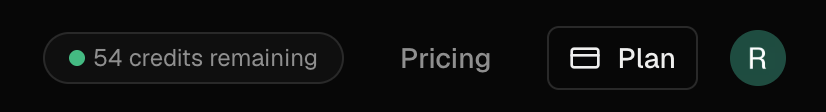

AI features carry variable, sometimes large per-action costs, and customers won't adopt what they can't predict. A research agent that might burn 15-20 credits is a gamble unless the customer can see the price before they commit to running it.

## Common approaches

Most products show the cost after the fact: a usage page that ticks up once the action finishes, or a monthly invoice that arrives weeks later. The customer learns what something cost only after they've already spent it, which is precisely the uncertainty that stalls adoption of the most valuable, most expensive features.

That uncertainty has become a procurement issue, not just a UX one. When Microsoft burned through a year of AI credits in four months, every buyer started asking "do you have limit management?" before signing. Without a way to preview cost, customers either avoid your premium features or wrap them in their own guardrails, and "how much will this cost me?" turns into a recurring sales and support question.

## How Schematic fits in

Before the customer runs the action, your server checks the feature with the action's size attached, such as the maximum number of steps an agent run can take. Schematic answers whether the company can afford it, counting its credit balance and any per-request or daily limits, and returns the feature's consumption rate and the company's current balance in the same response. Multiply the size by the rate and you can render "this will cost up to 20 credits, you have 312 remaining" next to the button.

When the customer is short, the same check tells you why, so you can offer a credit bundle or an upgrade in the flow rather than failing the action. When they go ahead, reserve the credits as the action starts, so another run cannot spend them before this one finishes.

## What it looks like

The balance a pre-flight check reads against, 54 credits remaining across the grants that make it up. Rendering that number next to an action's estimated cost is what turns "run it and find out" into a decision the customer can make. Find it on the company profile under **Credit balance**.

## Configure it

- [Credit Burndown Billing Model](/billing/credit-burndown) — the credit balance and consumption rates a preview is priced from.
- [Usage Controls](/billing/usage-controls) — per-request and daily limits a preview checks against.
- [Credit Bundles and Auto Top-Up](/billing/credit-bundles-and-top-ups) — what to offer a customer who is short.

## Implement it

- [Show the cost before the customer commits](/billing/prevent-overspend#show-the-cost-before-the-customer-commits) — pass the action's size with the check and render the estimate.
- [Reserve before the work runs](/billing/prevent-overspend#reserve-before-the-work-runs) — hold the credits once the customer commits.
- [Preflight Checks](/feature-management/preflight-checks) — the full preflight reference.
